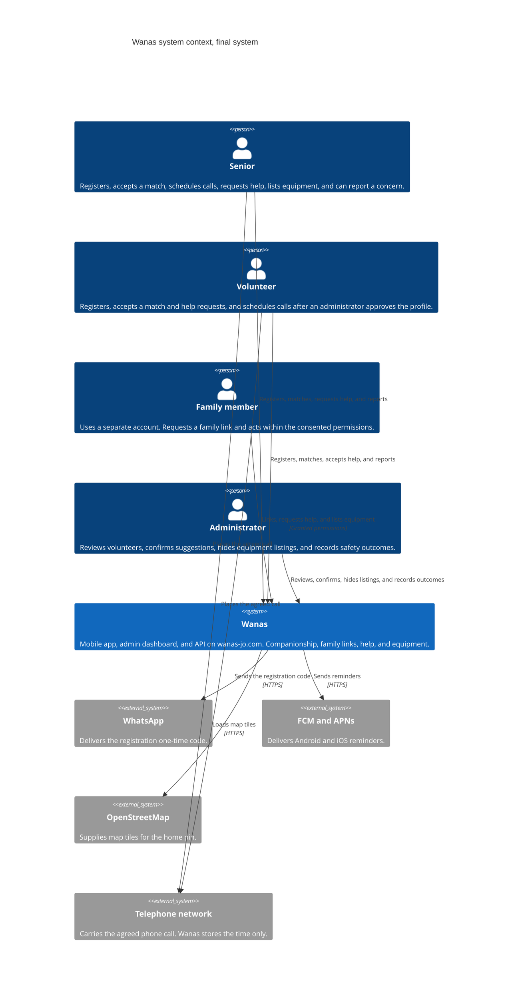

# 3. System Context and Scope

| | |
| --- | --- |
| **Project** | Wanas (ونس) |
| **Document section** | arc42 — Section 3: Context and Scope |
| **Status** | Draft for the final system |
| **Diagram** | C4 System Context (Level 1) |

This section draws the boundary around the final Wanas system. Everything inside that boundary is one software system. People and outside services sit around it. The containers inside the boundary are opened in Section 5.

Seniors, volunteers, and family members use one React Native app. Administrators use a separate Next.js dashboard. Both clients call one API on `wanas-jo.com`. The API, the dashboard, and PostgreSQL run together on one OVHcloud VPS-1. Family links, help requests, and equipment listings are inside that system. Equipment photos stay on the same machine.

## 3.1 System boundary

The Wanas box contains the software the team builds and operates:

| Inside Wanas | What it covers |
| --- | --- |
| Mobile app | Arabic and English screens for seniors, volunteers, and family members, including right-to-left layout. Registration, profiles, family links, the home-pin map, suggestions, call scheduling, help requests, equipment listings, and safety reports. |
| Admin dashboard | Browser screens for volunteer review, suggestion confirmation, equipment listings, and the outcome of a safety report. |
| API and worker | Accounts, roles, family links and consent, profiles, match suggestions, acceptance, schedules, reminders, help requests, equipment listings, and reports. The worker sends the registration code and the push reminder from the same application. Equipment photos are stored on this machine. |
| PostgreSQL | The stored accounts, profiles, family links, matches, acceptances, schedules, help requests, equipment listings, photos, handovers, notifications, and safety reports. |

A home pin and a phone number are stored inside this boundary. A response about another person returns `areaName` and a display name. The exact pin and the phone number stay inside Wanas, as TC-10 requires. A family member has a separate account. The link request, the consent, and the granted permissions are stored and acted on inside Wanas, as OC-05 requires.

The following stay outside the box. Wanas has no module and no workflow for them.

| Outside Wanas | Why it is outside |
| --- | --- |
| Medical care, medication, money handling, emergency response, and professional home care | OC-04. These are not services the platform provides. |
| The phone call itself | Wanas stores the agreed time and sends a reminder. The audio travels on the telephone network. |
| In-app chat and in-app voice or video | These stay outside this system. |
| Community centers, universities, and funders | Stakeholders from Section 1. They are not a software interface in this system. |

Google Play and the App Store distribute the mobile app. They are outside the runtime boundary. A match, a schedule, a help request, and a report do not call either store.

## 3.2 User roles

Four roles use Wanas. Each person signs in with their own account. A family member never uses the senior's password, as TC-11 requires.

| Role | How this person reaches Wanas | What they do inside the boundary |
| --- | --- | --- |
| Senior | The mobile app. | Creates an account, places a private home pin, keeps a profile, decides a family link, accepts or declines a suggestion, schedules a call on an active match, creates a help request, publishes an equipment listing, and can report a concern. |
| Volunteer | The mobile app. | Creates an account and a profile. Enters matching only after an administrator approves the profile, as OC-06 requires. Accepts or declines a suggestion, schedules a call, accepts a help request, publishes a listing or arranges a handover, and can report a concern. |
| Family member | The mobile app. | Creates a separate account and requests a link. Acts for a senior only after that senior has consented, and only within the permissions on that link. With `CanCreateHelpRequest`, creates a help request. With `CanViewSchedule`, views and schedules calls. Publishes an equipment listing of their own. A request outside those permissions is refused, and nothing is saved. |
| Administrator | The admin dashboard in a browser, on `wanas-jo.com`. | Reviews volunteer registrations, confirms a suggestion, hides an equipment listing, and records the outcome of a safety report. |

## 3.3 C4 system context diagram

Level 1 shows one Wanas system. It does not open the mobile app, the dashboard, the API, or the database. Those parts are inside the box and appear in the container diagram in Section 5.

The editable sources are [diagrams/c4-context.mmd](diagrams/c4-context.mmd) and [diagrams/c4-context.puml](diagrams/c4-context.puml).

The four people talk to Wanas. Wanas talks to WhatsApp, to FCM and APNs, and to OpenStreetMap. The senior and the volunteer place the agreed call on the telephone network. Wanas keeps the agreed time, the family link, the help request, and the equipment listing.

## 3.4 External dependencies

| Neighbor | What crosses the boundary | What stays inside Wanas |
| --- | --- | --- |
| WhatsApp | A one-time registration code, sent to the person's phone number. | The account, the role, and the decision that the code matched. The phone number is not placed on a public profile. |
| FCM and APNs | A reminder for a scheduled call, addressed to that person's device. | The call row and the reminder status. A rejected push leaves the call scheduled, as Section 6 shows. |
| OpenStreetMap | Map tiles requested by the phone while the person places a home pin. | The saved coordinates. OpenStreetMap is a tile source, not an account system. Other people see the area name, not the pin. |
| Telephone network | The voice call between the senior and the volunteer at the agreed time. | The scheduled time, the match it belongs to, and the later status: completed, cancelled, or missed. |
| Google Play and the App Store | The published Android and iOS builds. | Nothing at runtime. Accounts, matches, and reports are not sent to either store. |

OVHcloud provides the single VPS. It is the place the system runs. Registration, matching, scheduling, help requests, and equipment listings stay inside Wanas.

## 3.5 Major interactions

1. A senior or volunteer asks Wanas for a registration code. Wanas stores the pending code and asks WhatsApp to deliver it. A matching code creates the account and removes the code. A wrong or expired code creates no account.
2. The mobile app loads OpenStreetMap tiles so the person can drop a home pin. The coordinates are saved on the profile inside Wanas.
3. Wanas reads the profiles and stores a suggestion. The suggestion stays inactive until the senior and the volunteer have both accepted it. An administrator confirms it before that acceptance is complete. A family member without permission cannot change the match.
4. On an active match, Wanas stores a call time. When the reminder is due, Wanas asks FCM or APNs to notify the phone. The two people then place the call on the telephone network.
5. A senior, a volunteer, or a family member with permission submits a safety report. An administrator reads it in the dashboard and records the outcome. The report and the outcome stay in Wanas.
6. A family member asks for a link to a senior. Wanas stores the link as pending. The senior approves or withdraws it and sets `CanCreateHelpRequest` and `CanViewSchedule`. The family member then acts only within those flags.
7. A senior, or a family member with `CanCreateHelpRequest`, creates a help request in one of the four everyday categories. Wanas stores it as open. An approved volunteer accepts it. A family member without that permission receives 403, and nothing is saved.
8. A person publishes an equipment listing and can add a photo. Another person arranges the handover. An administrator can hide the listing. The photo file stays on the VPS.

## 3.6 Scope of this context

This context covers accounts, profiles, family links, matching, scheduling, reminders, help requests, equipment listings, safety, and administration. Section 5 opens the box into the mobile app, the admin dashboard, the API, and PostgreSQL. Section 6 follows registration, match acceptance, the call reminder, and a help request through those parts.

## 3.7 References

- Section 1, `01-introduction-goals-requirements.md`, for the four roles and the product scope. In-app chat and in-app voice or video stay outside this boundary.
- Section 2, `02-architecture-constraints.md`, especially TC-01, TC-05, TC-08, TC-09, TC-10, TC-11, OC-04, OC-05, and OC-06.
- Section 4, `04-solution-strategy.md`, for the mobile app, the admin dashboard, WhatsApp, OpenStreetMap, and push.
- Section 6, `06-runtime-view.md`, for registration, match acceptance, the call reminder, and a help request.
- C4 model, system context diagram: https://c4model.com/diagrams/system-context
- arc42 Section 3, Context and Scope: https://docs.arc42.org/section-3/
