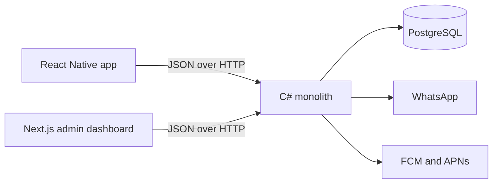

# 4. Solution Strategy

| | |
| --- | --- |
| **Project** | Wanas (ونس) |
| **Document section** | arc42 — Section 4: Solution Strategy |
| **Status** | Draft for the final system |
| **Related section** | Section 2 records the limits. This section records the decisions that shape the final system inside those limits. |

This section describes the final Wanas system. Seniors, volunteers, and family members use one React Native app. Administrators use a separate Next.js dashboard. There is no website for seniors or volunteers. The API and the admin dashboard run on one OVHcloud VPS-1. The domain includes accounts, profiles, family links, matching, scheduling, notifications, help requests, equipment listings, safety, and administration.

## 4.1 Application type and responsibility split

Wanas is a mobile client for participants and a browser client for administrators, with one backend.

| Part | Responsibility |
| --- | --- |
| React Native app | One Android and iOS app for seniors, volunteers, and family members. Registration, profiles, family links, match suggestions, call scheduling, help requests, and equipment listings. Arabic and English, including right-to-left layout. Screens and local state only. |
| Next.js admin dashboard | A separate browser application. Administrators review volunteers, confirm suggestions, hide equipment listings, and handle safety reports. |
| C# monolith | Domain rules, the JSON API, Entity Framework, and the in-process worker. |
| PostgreSQL | Accounts, profiles, family links, matches, acceptances, schedules, notifications, help requests, equipment listings, and safety records. |
| Docker Compose on the VPS | Runs the admin dashboard, the monolith, and PostgreSQL on the single host from TC-01. |

The admin dashboard and the mobile app call one JSON API. Authorization, validation, and business rules stay in the monolith, as CV-03 and CV-06 require. A scheduled call is stored as an interaction. The phone call itself stays on the normal phone channel.

In-app chat and in-app voice or video stay outside this strategy.

## 4.2 Architecture style

The backend is one monolithic .NET application. The host has 2 vCores and 4 GB RAM, so the deployable backend is one process. Microservices were set aside because they would spend that machine on network hops and extra processes.

### Clean architecture

The monolith is split into four layers:

| Layer | What it owns |
| --- | --- |
| Domain | Roles, consent, match acceptance, help requests, equipment listings, and the private home pin. |
| Application | Use cases that the API and the worker both call. |
| Infrastructure | Entity Framework Core, PostgreSQL, WhatsApp, push notifications, and uploaded files. |
| HTTP interface | The JSON API used by the Next.js admin dashboard and the React Native app. |

The domain does not reference Entity Framework, Next.js, or React Native. A change to a registration screen stays in the client. A change to a matching rule, a help request, or an equipment listing stays in the domain.

### Domain-driven design

The code uses the product language from CV-01: account, profile, match, interaction, consent, help request, equipment listing, and report. Those concepts are aggregates. The bounded contexts are modules inside the one deployable monolith:

| Bounded context | Responsibility |
| --- | --- |
| Accounts and access | Identity, roles, the family link and its consent, and the WhatsApp registration code. |
| Profiles | Interests, language, availability, and the private home pin. |
| Matching | Suggestions from shared interests, language, and area. An administrator confirms a proposed suggestion. It stays inactive until the senior and the volunteer have both accepted it. |
| Scheduling | Agreed call times and interaction status. |
| Help requests | Everyday requests in four categories, sent to the matched volunteer or to approved volunteers, then accepted or completed. |
| Equipment | Donate, lend, and request listings, their photos, and the handover. |
| Notifications | Reminders and mobile push. |
| Safety | Reports and the recorded outcome. |
| Administration | Volunteer review, match confirmation, and hiding an equipment listing. |

Matching can change without a change to registration or to notification delivery. A help-request change or an equipment change stays inside its own module. These modules share one database and one process.

## 4.3 Technology decisions

Each choice below is kept because of the advantage it gives Wanas and because it fits the rest of this system. Popularity is not the reason.

| Decision | Advantage for Wanas | Fit with the rest of the system | Alternative set aside |
| --- | --- | --- | --- |
| C# on .NET | One language holds the domain, the JSON API, Entity Framework, and the worker. | All of that runs as one process on the 4 GB VPS. | Node, Python, Java, or PHP for the backend. Node remains only in Next.js, which does not own the domain. |
| Clean architecture | Match acceptance, role checks, and the hidden home pin sit in the center. | Infrastructure and clients can change without rewriting those rules. | One undivided layer, where a screen change and a matching rule would be mixed. |
| Domain-driven design | The product names are already the code names. | Nine modules share one deployable application. | Extra services for each module. |
| Next.js | Administrators get a separate dashboard for review, confirmation, equipment listings, and safety reports. | The dashboard is a client of the same API. Seniors and volunteers do not use it. | Razor or Blazor inside the monolith, or a public website for seniors and volunteers. |
| React Native | Seniors, volunteers, and family members share one Android and iOS app. | That app calls the same JSON API. TC-12 already provides the store accounts used to publish it. | A separate Swift app and a separate Kotlin app, or a website for those three roles. |
| JSON over HTTP | The admin dashboard and the mobile app share one contract. | Authorization happens once, at the API boundary. | GraphQL or gRPC. |
| Entity Framework Core | It maps the companionship model onto PostgreSQL and produces the migrations used in CV-15. | It stays in the infrastructure layer. The domain does not reference it. | Dapper with hand-written SQL around the same aggregates. |
| In-process .NET worker | Reminders and push reuse the same use cases and the same database as the API. | The job stays inside the monolith’s migrations and configuration. | A second worker container, or a cron job on the host. |
| PostgreSQL | Matches, acceptances, roles, consent, help requests, and equipment listings are relational records. | The database runs beside the API on the VPS from TC-03. | A second database server. |
| Docker Compose on OVHcloud VPS-1 | The admin dashboard, the monolith, and PostgreSQL are one stack the team can operate. | It matches TC-01, TC-02, and CV-13. | More machines, or a managed database outside this host. |
| OpenStreetMap tiles in the mobile app | Seniors and volunteers drop a home pin during registration in the app so matching can use area. There is no map fee. | The pin is stored for matching and is omitted from public profiles, as TC-10 requires. | Google Maps, which would bill for the same pin and send the home location to another Google API. |
| WhatsApp for the registration code | The code reaches a phone seniors and volunteers already use. | The message contains a one-time code. The phone number stays off public profiles. | SMS through another telecom provider, or email as the only registration check. |
| Match suggestions inside the monolith | Shared interests, language, and map area are already on the profiles. | An administrator confirms the suggestion. It stays inactive until the senior and the volunteer accept it, as OC-06 requires. | A fully manual match with no suggestions, a suggestion that becomes active on its own, or a separate matching service. |

## 4.4 Clients and registration

Seniors, volunteers, and family members use the React Native app. Seniors and volunteers register there. Registration has two external steps:

1. WhatsApp sends a one-time code to the person’s phone. The monolith checks that code before the account becomes active.
2. The person places a home pin on a map that loads OpenStreetMap tiles. The coordinates are stored on the profile for area matching. The profile shown to other people withholds the exact home location and phone number.

Administrators do not use that app for their work. Their dashboard is a separate Next.js application for volunteer review, suggestion confirmation, equipment listings, and safety reports. Family members are a role inside the mobile app, with a consented link. They are not a separate deployable app, and they are not a separate bounded context in this strategy.

Help requests and equipment listings are part of this same app and the same monolith.

## 4.5 Third parties

| Third party | Role in the final system |
| --- | --- |
| OVHcloud | Hosts the single VPS-1. |
| Google | Google Play publishes the Android app. Firebase Cloud Messaging delivers Android push. |
| Apple | The App Store publishes the iOS app. Apple Push Notification service delivers iOS push. |
| WhatsApp | Sends the registration one-time code. |

OpenStreetMap provides the map tiles shown in the mobile app during registration. It is a tile source for the home pin, not an account system.

## 4.6 References

- Section 2, `02-architecture-constraints.md`, especially TC-01, TC-02, TC-03, TC-06, TC-07, TC-09, TC-10, TC-12, OC-06, CV-03, CV-06, CV-13, and CV-15.
- Section 1, `01-introduction-goals-requirements.md`, for the product scope. In-app chat and in-app voice or video stay outside this strategy.
- arc42 Section 4, Solution Strategy: https://docs.arc42.org/section-4/
