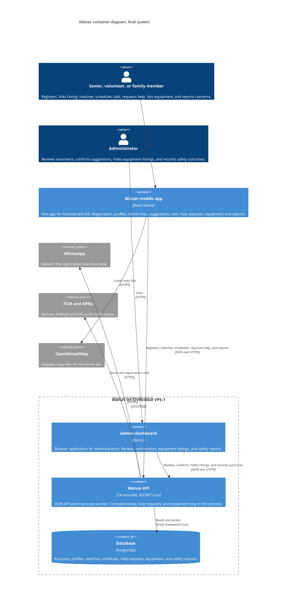
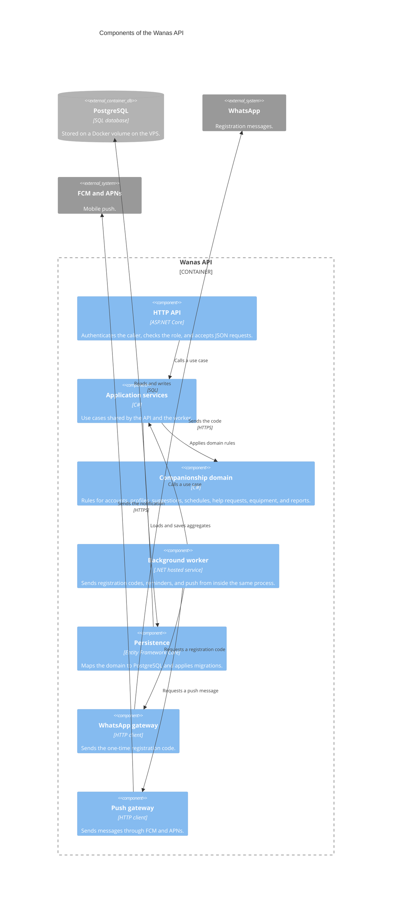

# 5. Building Block View

| | |
| --- | --- |
| **Project** | Wanas (ونس) |
| **Document section** | arc42 — Section 5: Building Block View |
| **Status** | Draft for the final system |
| **Diagrams** | C4 Container (Level 2) and C4 Component (Level 3) |

This section breaks the final Wanas system into the containers that run it, then opens the API into its internal components. Seniors, volunteers, and family members use one React Native app. Administrators use a separate Next.js dashboard. There is no website for seniors or volunteers.

The editable diagram sources are [diagrams/c4-container.mmd](diagrams/c4-container.mmd), [diagrams/c4-container.puml](diagrams/c4-container.puml), [diagrams/c4-component-api.mmd](diagrams/c4-component-api.mmd), and [diagrams/c4-component-api.puml](diagrams/c4-component-api.puml).

## 5.1 Why the system is split this way

The host is one OVHcloud VPS-1, so the server side is three containers: the admin dashboard, the C# monolith, and PostgreSQL. The mobile app is a fourth building block, installed from the stores, and it is not deployed on that machine. Business rules stay in the monolith. The app and the dashboard render screens and call one JSON API.

Help requests and equipment listings are modules inside the Wanas API. Equipment photos are files on a Docker volume on the same VPS. In-app chat and in-app voice or video are outside this view. A family member is a role in the mobile app, with a consented link.

## 5.2 Container view

### 5.2.1 C4 container diagram

The mobile app sits outside the VPS boundary because it runs on the phone. The admin dashboard, the API, and PostgreSQL share the VPS and are started together with Docker Compose. PostgreSQL accepts connections only from the API on the Docker network. Public HTTPS on `wanas-jo.com` reaches the admin dashboard and the API.

The API box includes the in-process worker. That worker is not a second container. WhatsApp, FCM, and APNs are called by the API process. The phone loads OpenStreetMap tiles directly while the person places a home pin. The coordinates are then saved through the API. The exact pin and the phone number stay off public screens. Equipment photos sit on a Docker volume on the VPS. The API writes them, and PostgreSQL stores the photo row.

### 5.2.2 Containers

| Building block | Purpose | Responsibilities | Interface | Depends on |
| --- | --- | --- | --- | --- |
| Wanas mobile app | The only client for seniors, volunteers, and family members. | Arabic and English screens, including right-to-left layout. Registration, the home-pin map, profiles, family links, suggestion review, call scheduling, help requests, equipment listings, and safety reports. Holds local screen state. | JSON over HTTPS to the Wanas API. Map tiles over HTTPS from OpenStreetMap. Push received from FCM and APNs. | Wanas API, OpenStreetMap, the phone's push service. |
| Admin dashboard | The only browser application. | Volunteer review, suggestion confirmation, equipment-listing review, and the safety-report outcome. Administrator sign-in. | JSON over HTTPS to the Wanas API. | Wanas API. |
| Wanas API | The system of record and the rule engine. | Role checks, WhatsApp registration codes, profiles, family links, match suggestions, acceptance, schedules, reminders, push, help requests, equipment listings, and reports. | JSON over HTTPS for both clients. SQL to PostgreSQL. HTTPS to WhatsApp, FCM, and APNs. | PostgreSQL, the volume for equipment photos, WhatsApp, FCM, APNs. |
| PostgreSQL | Durable records for companionship, help requests, and equipment. | Stores accounts, profiles, family links, matches, acceptances, schedules, notifications, help requests, equipment rows, and safety reports. | SQL from the API, through Entity Framework Core. | The Docker volume on the VPS. |

Google Play and the App Store distribute the mobile app. They are not runtime containers.

## 5.3 Component view of the Wanas API

The API is the building block that holds the rules, so it is the one opened to components. The mobile app and the admin dashboard are thin clients and are left closed.

### 5.3.1 C4 component diagram

A request enters through the HTTP API, which rejects a caller who lacks the role. The application service runs one use case and asks the domain whether the action is allowed. Persistence reads and writes PostgreSQL. The worker uses the same application services, then asks the WhatsApp gateway or the push gateway to deliver a message. The domain does not call WhatsApp, the push networks, or Entity Framework.

### 5.3.2 Components

| Component | Purpose | Responsibilities | Interface | Depends on |
| --- | --- | --- | --- | --- |
| HTTP API | The door for both clients. | Authenticates the session, checks the role, validates the JSON shape, and returns a clear success or failure. | HTTPS JSON from the mobile app and the admin dashboard. Method calls into application services. | Application services. |
| Application services | One place for each user action. | Registration, profile update, family consent, suggestion, acceptance, scheduling, reminder dispatch, help requests, equipment listings, and safety reports. | Method calls from the HTTP API and the worker. | Companionship domain, persistence. |
| Companionship domain | The rules that must stay true. | Accounts and roles, private home pin, suggestions from interests, language, and area, acceptance before a match is active, schedules, help-request categories, equipment listings, and report outcomes. | Method calls from application services. | No infrastructure and no client. |
| Background worker | Timed and outbound work inside the API process. | Asks application services to issue a registration code, mark a reminder due, or prepare a push. | Method calls into application services, the WhatsApp gateway, and the push gateway. | Application services, WhatsApp gateway, push gateway. |
| Persistence | The PostgreSQL adapter. | Loads and saves aggregates. Applies migrations before the new API container serves traffic. Stores the equipment-photo row with its file key. | Method calls from application services. SQL to PostgreSQL. | PostgreSQL. |
| WhatsApp gateway | The registration-message adapter. | Sends the one-time code. Does not decide whether the account may be created. | Method call from the worker. HTTPS to WhatsApp. | WhatsApp. |
| Push gateway | The mobile-notification adapter. | Sends the prepared message to FCM or APNs. Does not decide who should be notified. | Method call from the worker. HTTPS to FCM and APNs. | FCM, APNs. |

Inside the companionship domain, the modules stay separate so a matching change does not require a registration or notification change:

| Module | Keeps |
| --- | --- |
| Accounts and access | The person, the role, the family link and its permissions, and the registration-code check. |
| Profiles | Interests, language, availability, and the private home pin. |
| Matching | A suggestion and the acceptance record. An administrator confirms it, and it stays inactive until the senior and the volunteer have both accepted. |
| Scheduling | The agreed call time and the interaction status. The phone call itself is placed outside Wanas. |
| Help requests | An everyday request in one of four categories, its audience, and the volunteer who accepted it. |
| Equipment | A donate, lend, or request listing, its photos, and the handover. |
| Notifications | The reminder and the push request. Delivery is left to the gateways. |
| Safety | The report and the outcome recorded by an administrator. |
| Administration | Volunteer review, confirmation of a suggestion, and hiding a listing. |

These modules are folders and types inside the domain component. They are not extra deployable services.

## 5.4 What is intentionally left out

The mobile app is not split into components here. Its screens change often, and they do not own rules. The admin dashboard is the same kind of client, limited to administrator actions. A second component diagram for either client would repeat the API's use cases.

In-app chat and in-app voice or video are outside this view. Help requests and equipment listings are modules inside the Wanas API.

## 5.5 References

- Section 4, `04-solution-strategy.md`, for the monolith, clean architecture, domain-driven design, and the technology choices.
- Section 2, `02-architecture-constraints.md`, especially TC-01, TC-02, TC-03, TC-07, TC-10, TC-11, CV-06, CV-07, and CV-11.
- Section 1, `01-introduction-goals-requirements.md`, for the roles and the product scope.
- C4 model: https://c4model.com/
- arc42 Section 5, Building Block View: https://docs.arc42.org/section-5/
