# Wanas System Design

| | |
| --- | --- |
| **Project** | Wanas (ونس) |
| **Document** | Software architecture, arc42 |
| **System** | React Native app, Next.js admin dashboard, one C# API, PostgreSQL |

This document is the architecture of the final Wanas system. Seniors, volunteers, and family members use one mobile app. Administrators use the dashboard. Companionship, family links, help requests, equipment listings, safety, and administration are in this design. In-app chat and in-app voice or video are not.

The twelve sections follow below. Diagrams are in `docs/diagrams/`. Decision records are in `docs/adr/`. The API specification is also copied to `docs/api/api.md`.


# 1. Introduction, Goals & Requirements

| | |
| --- | --- |
| **Project** | Wanas (ونس) |
| **Document section** | arc42 — Section 1: Introduction, Goals & Requirements |
| **Status** | Draft for the final system |
| **Initial context** | Jordan |
| **Primary focus** | The full Wanas system: one React Native app for seniors, volunteers, and family members, and a Next.js admin dashboard. The first operational pilot can start with companionship. |

## 1.1 Project Overview

Wanas is a community platform that connects older adults with young volunteers to build meaningful relationships through regular conversations, phone calls, and, where appropriate, in-person meetings.

The platform is based on the idea that support for older adults is not only about providing services. It is also about listening, sharing experiences, exchanging knowledge between generations, and helping people feel connected to their community.

Wanas will help older adults find compatible volunteers based on shared interests, location, language, and availability. It will also provide a simple way to arrange recurring calls and visits. It includes practical help requests from older adults and their families, and the free sharing or lending of useful equipment. The first operational pilot can start with companionship.

Seniors, volunteers, and family members use one React Native app. Administrators use a separate Next.js dashboard. Arabic and English are supported, including a right-to-left layout for Arabic. There is no public website for seniors or volunteers.

Wanas is intended to be a community-support platform, not a medical-care, nursing, emergency-response, or financial service.

## 1.2 Problem Statement

Some older adults may experience loneliness, limited social interaction, or difficulty finding regular opportunities to connect with people outside their usual circle. Their families may also want them to have more social contact and support, but may not always have enough time or access to suitable community programs.

At the same time, young people may be willing to volunteer, listen, share their skills, and learn from older generations, but they may not have a simple and trusted way to connect with older adults and maintain regular contact.

Existing informal arrangements can be difficult to organize. A connection may depend on personal contacts, and calls or visits may stop when there is no clear schedule or follow-up.

Wanas aims to address this gap by providing a simple way to:

- Connect older adults with suitable volunteers.
- Help both sides build and maintain regular contact.
- Arrange calls and visits in a clear, organized way.
- Allow seniors and authorized family members to request suitable everyday help.
- Encourage the community to share useful equipment.

The project must also address trust, privacy, consent, reliability, and personal safety. These are important parts of the service, not optional additions.

## 1.3 Project Goals

The main goals of Wanas are:

| ID | Goal | Expected result |
| --- | --- | --- |
| G-01 | Reduce social isolation through regular human contact. | Seniors can build ongoing relationships with volunteers. |
| G-02 | Create suitable connections between generations. | Matching considers interests, location, language, and availability. |
| G-03 | Make companionship easier to organize. | Users can arrange and remember calls and visits. |
| G-04 | Give seniors a simple way to request suitable everyday help. | Requests can be sent to a matched volunteer or an approved volunteer community. |
| G-05 | Involve families without removing the senior's independence. | Family members can help through separate accounts and controlled permissions. |
| G-06 | Encourage community sharing. | People can offer or request useful equipment for free when this service is introduced. |
| G-07 | Build a safe and trusted service. | Users can report concerns, request a new match, and receive support from administrators. |
| G-08 | Validate the idea with limited resources. | A small pilot can test the service before major technical investment. |

## 1.4 Target Users and Stakeholders

### 1.4.1 Seniors

Older adults in Jordan who are interested in social interaction, companionship, or suitable everyday community support.

They should be able to use Wanas with as little technical effort as possible. Some seniors may prefer help from a family member or a coordinator when registering or using the platform.

Main needs:

- Find a volunteer with shared interests.
- Choose how and when to communicate.
- Arrange regular calls or visits.
- Ask for suitable help.
- Feel respected and in control of their participation.
- Stop a connection or request a different volunteer if they feel uncomfortable.

### 1.4.2 Volunteers

People who are willing to give time to older adults. The initial project assumption focuses on young volunteers aged 18–35.

Volunteers may offer conversation, listening, shared activities, knowledge exchange, and approved non-professional help.

Main needs:

- Create a profile and state their interests and availability.
- Review and accept or decline match requests.
- Arrange calls and visits.
- View and respond to suitable help requests.
- Understand the service rules and their boundaries.
- Report concerns and manage their volunteering commitments.

### 1.4.3 Family Members

Relatives or trusted people who want to help a senior use Wanas.

A family member has a separate account linked to the senior's profile. The senior remains the main person receiving the service. Family access is controlled by the senior's consent and the permissions granted.

Main needs:

- Help a senior register and complete their profile.
- Suggest or help review volunteer matches.
- Submit help requests on the senior's behalf.
- Coordinate calls or visits where permitted.
- Follow request status and receive relevant updates.

Family members do not automatically gain access to private conversations or the right to act as the senior. These permissions must be handled separately and clearly.

### 1.4.4 Administrators

Wanas team members who manage the platform and support its users.

Main needs:

- Review and verify volunteer registrations.
- Manage senior and volunteer accounts.
- Create, review, and manage matches.
- Help resolve matching problems.
- Review reports and safety concerns.
- Monitor help requests and equipment listings.
- View basic platform activity and pilot results.

### 1.4.5 Other Stakeholders

- **Local community centers and NGOs:** Potential partners who can help reach seniors, support registration, or provide safe meeting locations.
- **Universities and student groups:** Potential sources of volunteers and project support.
- **Corporate CSR programs and grant providers:** Possible future sources of financial support.
- **Senior families and caregivers:** Important stakeholders in trust, consent, and coordination.

Partnerships and funding are possible future directions, not confirmed dependencies for the initial MVP.

## 1.5 User Roles and Account Model

Wanas has four main roles:

| Role | Account model | Main responsibility |
| --- | --- | --- |
| Senior | Individual account and senior profile | Receives companionship and support. |
| Volunteer | Individual account and volunteer profile | Provides time and approved support. |
| Family member | Individual account linked to one or more senior profiles | Supports a senior with permission. |
| Administrator | Staff account with administrative permissions | Operates and supervises the platform. |

All normal users can use one shared authentication system. Seniors, volunteers, and family members use the React Native app. Administrators use the Next.js dashboard. The role and permissions assigned to each account determine which screens and actions are available.

Family access model:

- The family member uses their own login details; they do not share the senior's password.
- A family member must be linked to a senior profile through an approval or consent process.
- A senior may have more than one linked family member.
- Different family members may receive different permissions.
- Access can be changed or withdrawn.
- Private conversations remain private unless the senior explicitly chooses otherwise or a clearly defined safeguarding process requires action.

The exact process for confirming consent, including cases where a senior cannot provide informed consent, must be defined before real users are onboarded.

## 1.6 Functional Requirements

The following requirements describe what the system should do. They are written so that they can later be checked through testing.

**Priority meanings:**

- **High:** Required for the initial MVP.
- **Mid:** Valuable, but can follow after the core pilot.
- **Low:** A possible later improvement.

### 1.6.1 Registration and Profiles

| ID | Requirement | Priority |
| --- | --- | --- |
| FR-01 | The system shall allow seniors, volunteers, and family members to create individual accounts. | High |
| FR-02 | The system shall provide a separate profile type for seniors, volunteers, and family members. | High |
| FR-03 | The system shall allow users to update their own profile information. | High |
| FR-04 | A senior profile shall include basic information, location, interests, preferred language, and communication preferences. | High |
| FR-05 | A volunteer profile shall include basic information, location, interests, languages, availability, and preferred volunteering activities. | High |
| FR-06 | The system shall allow a family member to request a link to a senior profile. | Mid |
| FR-07 | The system shall record whether the senior has approved the family link and what permissions were granted. | Mid |
| FR-08 | The system shall allow administrators to review volunteer registrations before they can participate in matching. | High |

### 1.6.2 Matching and Connections

| ID | Requirement | Priority |
| --- | --- | --- |
| FR-09 | The system shall allow administrators to find suitable volunteers for a senior using profile information. | High |
| FR-10 | Matching shall consider shared interests, location, language, availability, and communication preferences. | High |
| FR-11 | The system shall allow a proposed match to be reviewed before the connection becomes active. | High |
| FR-12 | The system shall record whether the senior and volunteer have accepted the connection. | High |
| FR-13 | The system shall allow a user to request a different match or report an uncomfortable connection. | High |
| FR-14 | The system shall allow administrators to review and manage match changes. | High |
| FR-15 | The initial pilot shall support manual or semi-manual matching rather than depending on a complex automated algorithm. | High |
| FR-16 | The system shall suggest volunteers who share a senior's interests and live nearby. A suggestion shall not become an active match until the required people confirm it. | Mid |

### 1.6.3 Communication and Scheduling

| ID | Requirement | Priority |
| --- | --- | --- |
| FR-17 | The system shall allow users in an active match to see the agreed communication arrangements. | High |
| FR-18 | The system shall support arranging a date and time for a phone call. | High |
| FR-19 | The system shall support arranging an in-person visit or activity, subject to the platform's safety rules. | Mid |
| FR-20 | The system shall send reminders for scheduled calls or meetings through the notification method available in the MVP. | Mid |
| FR-21 | The system shall allow users to cancel or reschedule an agreed interaction. | Mid |
| FR-22 | The system shall record basic interaction status, such as scheduled, completed, cancelled, or missed. | Mid |
| FR-23 | The system shall provide chat between a senior and a volunteer in an active match. | Mid |
| FR-24 | The system shall provide voice or video calls between a senior and a volunteer in an active match. | Mid |
| FR-25 | The system shall keep an active match open after a completed call or visit so the pair can schedule further contact. | High |

### 1.6.4 Helping Hands

Helping Hands is a structured way for a senior to ask for everyday, non-professional assistance from the matched volunteer or the wider approved volunteer community. It remains in this system. The first operational pilot can start with companionship.

| ID | Requirement | Priority |
| --- | --- | --- |
| FR-26 | The system shall allow a senior to create a help request in an approved category: grocery shopping, transportation or accompaniment to an appointment, technology and smartphone help, or a small everyday errand. | Mid |
| FR-27 | The system shall allow the requester to send the request to the matched volunteer or make it available to approved volunteers in the wider community. | Mid |
| FR-28 | A volunteer shall be able to accept or decline a help request. | Mid |
| FR-29 | A volunteer who accepted a request shall be able to mark it completed. | Mid |
| FR-30 | The system shall show the request status to the requester, such as open, accepted, completed, or cancelled. | Mid |
| FR-31 | A family member with permission shall be able to create a help request on behalf of a linked senior. | Mid |
| FR-32 | Help requests shall stay within approved non-professional tasks. The system shall not offer medical care, medication, money handling, or emergency response through a help request. | Mid |

### 1.6.5 Community Exchange

Community Exchange is a free equipment listing service for seniors. It remains in this system. The first operational pilot can start with companionship.

Possible listing types:

- **Donate:** Give an item permanently.
- **Lend:** Allow someone to use an item temporarily and return it.
- **Request:** Ask the community for an item that is needed.

Examples include walkers, wheelchairs, crutches, other mobility aids, medical beds, and other non-medication equipment.

| ID | Requirement | Priority |
| --- | --- | --- |
| FR-33 | A contributor shall be able to submit an equipment listing with a description, photos, condition, location, and listing type. | Mid |
| FR-34 | A user shall be able to browse available equipment and submit a request. | Mid |
| FR-35 | The system shall show an item's condition and whether it is available, reserved, collected, transferred, or no longer available. | Mid |
| FR-36 | Administrators shall be able to review, hide, or remove equipment listings. | Mid |
| FR-37 | The people involved in a listing shall be able to arrange collection of the item, and the system shall record that arrangement. | Mid |

### 1.6.6 Administration and Safety

| ID | Requirement | Priority |
| --- | --- | --- |
| FR-38 | The system shall provide an administrator interface for managing users and profiles. | High |
| FR-39 | Administrators shall be able to review volunteer verification information. | High |
| FR-40 | Users shall be able to report a safety or behavior concern. | High |
| FR-41 | Administrators shall be able to review reports and record the action taken. | High |
| FR-42 | The system shall allow administrators to suspend or deactivate an account when necessary. | High |
| FR-43 | The system shall support cancelling a match and arranging a new match. | High |
| FR-44 | The system shall keep a basic record of important administrative actions. | Mid |

### 1.6.7 Family Circle

Family Circle lets a family member take part with the senior's consent. The family member uses the React Native app through a consented link. Registration help can be done manually in the first operational pilot.

| ID | Requirement | Priority |
| --- | --- | --- |
| FR-45 | A family member with the senior's consent shall be able to update the linked senior's profile within the permissions granted. | Mid |
| FR-46 | A family member shall be able to view the linked senior's scheduled calls, visits, and help-request statuses allowed by their permissions. | Mid |
| FR-47 | A family member shall receive notifications about important updates they are permitted to see. | Mid |
| FR-48 | A family member with permission shall be able to help coordinate a scheduled call or visit for the linked senior. | Mid |

A family member creates a help request for the senior through FR-31. Linking the account and recording consent are FR-06 and FR-07.

## 1.7 Main Use Cases

The following use cases describe the most important ways people will use Wanas.

### UC-01: Register as a Senior

**Primary actor:** Senior

**Supporting actor:** Family member or administrator, if needed

1. The senior or an authorized helper opens the registration process.
2. Basic information and preferences are entered.
3. The senior's location, interests, language, and preferred communication method are recorded.
4. The senior reviews the information and confirms participation through the defined consent process.
5. The profile becomes available for matching after any required review.

**Expected result:** A senior profile is created and is ready for matching.

### UC-02: Register and Verify a Volunteer

**Primary actor:** Volunteer

**Supporting actor:** Administrator

1. The volunteer creates an account.
2. The volunteer enters their interests, location, languages, and availability.
3. The volunteer agrees to Wanas rules and boundaries.
4. The administrator reviews the registration and verification information.
5. The volunteer is approved, rejected, or asked for more information.

**Expected result:** Only approved volunteers can take part in active matching.

### UC-03: Match a Senior with a Volunteer

**Primary actor:** Administrator

**Supporting actors:** Senior and volunteer

1. The system provides the information needed to compare suitable profiles.
2. The administrator reviews possible volunteers based on the matching factors.
3. A proposed connection is shared with the relevant people.
4. The senior and volunteer accept or decline.
5. The system records the result.
6. If both accept, the connection becomes active.

**Expected result:** An active match is created only after the required acceptance steps.

### UC-04: Arrange a Recurring Call

**Primary actors:** Senior and volunteer

1. The senior and volunteer agree on a suitable day and time.
2. The call is recorded as a scheduled interaction.
3. The platform sends reminders when supported.
4. After the planned time, the interaction can be marked as completed, cancelled, or missed.
5. The next call can be arranged.

**Expected result:** Both sides have a clear schedule for regular contact.

### UC-05: Request Everyday Help

**Primary actor:** Senior or authorized family member

**Supporting actors:** Volunteer and administrator

1. The requester selects a help category and describes what is needed.
2. The requester chooses a personal request or community request, where available.
3. The request is sent to the matched volunteer or made available to suitable approved volunteers.
4. A volunteer accepts or declines.
5. The request is assigned and its status is updated.
6. The requester and volunteer coordinate the agreed details.
7. The request is marked as completed or cancelled.

**Expected result:** The request has a clear owner and status, and its progress can be followed.

### UC-06: Link a Family Member to a Senior

**Primary actors:** Family member and senior

1. The family member creates their own account.
2. The family member requests access to the senior's profile.
3. The senior approves the link and selects the allowed permissions through the defined process.
4. The system records the relationship and permissions.
5. The family member can perform only the approved actions.

**Expected result:** A family member can support a senior without sharing login details or receiving automatic access to private information.

### UC-07: Report a Concern and Request a New Match

**Primary actor:** Senior, family member with permission, or volunteer

**Supporting actor:** Administrator

1. A user submits a report or requests a new match.
2. The system records the report and notifies the responsible administrator.
3. The administrator reviews the information and contacts the relevant people when appropriate.
4. The administrator takes suitable action, which may include pausing contact, ending the match, or suspending an account.
5. The outcome is recorded.

**Expected result:** Users have a clear way to raise concerns and the team can respond.

### UC-08: Offer or Request Equipment

**Primary actors:** Community contributor and senior or family member

**Supporting actor:** Administrator

1. A contributor submits an item listing or a user submits an equipment request.
2. The listing is reviewed according to the equipment rules.
3. An interested person requests the item.
4. The parties agree on a safe handover or return arrangement.
5. The listing status is updated.

**Expected result:** Equipment can be offered or requested through a controlled process when the feature is enabled.

## 1.8 Non-Functional Requirements

Non-functional requirements describe how well and how safely the system should work.

| ID | Quality area | Requirement |
| --- | --- | --- |
| NFR-01 | Usability and accessibility | Main senior tasks shall use clear language, readable text, large controls, and as few steps as practical. |
| NFR-02 | Privacy | Personal phone numbers and home addresses shall not be shown publicly or shared before there is a clear need and appropriate consent. |
| NFR-03 | Authorization | Users shall only access information and actions allowed by their role and granted permissions. |
| NFR-04 | Consent | The platform shall record the required consent for participation and family access. |
| NFR-05 | Security | Passwords and sensitive information shall be protected using appropriate security practices. |
| NFR-06 | Safety | The platform shall provide a way to report concerns, request a new match, and contact the responsible team. |
| NFR-07 | Reliability | The system shall store important profile, match, and request changes so that they are not lost during normal use. |
| NFR-08 | Maintainability | The system shall keep user accounts, profiles, matches, interactions, and requests as clear, separate concepts. |
| NFR-09 | Cost | The MVP shall use a low-cost approach and avoid infrastructure or integrations that are not needed to validate the idea. |
| NFR-10 | Scalability | The design should allow more seniors, volunteers, neighborhoods, and partner organizations to be added without redesigning the whole system. |
| NFR-11 | Compatibility | Seniors, volunteers, and family members shall use one React Native app. Administrators shall use a Next.js dashboard. Arabic and English, including a right-to-left layout, shall be supported. |
| NFR-12 | Accountability | Important actions, including match changes and safety decisions, should be recorded for later review. |

### Proposed measurable quality targets

These are initial targets for the pilot, not proven performance results. The team should review them after testing with real users.

| ID | Proposed target | How it can be checked |
| --- | --- | --- |
| QT-01 | A senior or family helper should be able to complete the basic registration flow in no more than 5 minutes with guidance available. | Observe pilot registration sessions. |
| QT-02 | A user should be able to submit a basic help or match-related request in no more than 3 minutes. | Time a usability test. |
| QT-03 | The main pages should load within 3 seconds under normal pilot conditions. | Measure page-load time during testing. |
| QT-04 | Every active match in the pilot should have recorded acceptance from both sides. | Review match records. |
| QT-05 | Every reported safety concern should have a recorded review and outcome. | Review the report log. |
| QT-06 | No user should be able to access another user's private information without permission. | Run role and access-control tests. |

## 1.9 Core Features and Priorities

The first operational pilot can start with companionship. The system documented in this architecture includes the React Native app, the Next.js admin dashboard, family links, help requests, and equipment listings.

### MVP — Initial Pilot

The first operational pilot can start with companionship and is intended to validate that model with limited resources. The assumptions document proposes starting with approximately five senior–volunteer pairs. Family links, help requests, and equipment listings are part of the documented system.

| Feature | MVP priority | Notes |
| --- | --- | --- |
| Senior and volunteer registration | High | Registration in the React Native app. Arabic and English, including a right-to-left layout. |
| Senior and volunteer profiles | High | Capture interests, location, language, and availability. |
| Volunteer review and approval | High | Manual review by the Wanas team. |
| Matching | High | Manual or semi-manual matching. |
| Match acceptance | High | Both sides should agree before contact begins. |
| Regular phone calls | High | Can use normal phone calls or an agreed external channel. |
| Call schedule and follow-up | High | A simple schedule and manual reminders may be enough at first. |
| Safety rules and reporting process | High | Include a clear way to raise concerns and request a new match. |
| Basic administrator tools | High | The team needs to manage users and matches during the pilot. |
| Personalized match suggestions | Mid | Suggestions use shared interests and nearby location. People still confirm the match. |
| In-app chat | Mid | After the core pilot. The pilot uses an ordinary phone call. |
| In-app voice or video calls | Mid | After the core pilot. |
| In-person visits and activities | Mid | Use approved public places or partner centers and clear safety procedures. |
| Helping Hands | Mid | Grocery shopping, transport or accompaniment, technology help, and small errands. Non-professional tasks only. |
| Community Exchange | Mid | Free donate, lend, or request. Show condition and availability, and arrange collection. |
| Family Circle | Mid | With consent: update the senior profile, request help, view schedules and statuses, receive updates, and help coordinate visits. Registration support can be manual in the pilot. |

The MVP does not need a complex matching algorithm, in-app calling, or a large automated workflow. The team can manage some activities manually while learning from the pilot.

### Later Versions

Family links, help requests, and equipment listings are already in the documented system. In-app chat and in-app voice or video stay later.

After the first operational pilot, Wanas may add:

- In-app messaging and, if justified, voice or video calls.
- Volunteer hours, recognition, and certificates.
- Community activities and group events.
- Partner or NGO dashboards.
- More automated matching and reporting.

## 1.10 Project Boundaries and Out-of-Scope Features of MVP

### What Wanas Is

- A platform for companionship and community connection.
- A way to organize regular contact between seniors and volunteers.
- A way to coordinate approved, non-professional everyday help.
- A community initiative that may support free equipment sharing.
- A platform that involves families while respecting the senior's independence.

### What Wanas Is Not

The following are outside the project's service boundaries, especially in the MVP:

- **Medical care:** Volunteers do not diagnose conditions, prescribe medication, provide treatment, or replace healthcare professionals.
- **Emergency response:** Wanas is not an emergency service. Users must contact the appropriate emergency services when urgent help is needed.
- **Financial assistance or transactions:** The platform will not handle loans, cash transfers, payments, or purchases using volunteer money.
- **Professional home care:** Volunteers are not a replacement for nurses, caregivers, or other trained professionals.
- **Unsupervised private meetings:** Early in-person pilot meetings should take place only in approved public places or partner centers, following the safety process.
- **Public website for seniors or volunteers:** Seniors, volunteers, and family members use the React Native app. Administrators use the Next.js dashboard.
- **Fully automated matching in the pilot:** Matching can be managed manually or semi-manually.
- **Guaranteed prevention of loneliness:** Wanas can create opportunities for social contact, but it cannot promise a specific psychological or medical outcome.

### Project Boundary Summary

Wanas is responsible for providing the platform, setting participation rules, managing its matching process, protecting user information, and responding to reports through a defined process. It should not promise services that it cannot safely provide or control.

A disclaimer or liability waiver does not replace responsible operation, reasonable safety measures, or the need to review applicable legal requirements.

## 1.11 Assumptions and Points to Validate

The project is based on assumptions, not all of which have been proven. The assumptions document highlights user behavior, trust, safety, operating cost, and long-term sustainability as areas that need attention.

### A. Assumptions to Test First

| ID | Assumption | Why it matters | How to validate it |
| --- | --- | --- | --- |
| A-01 | Older adults in Jordan who feel lonely are open to regular social interaction with people they do not already know. | The service depends on seniors being willing to participate. | Interview older adults and test a small number of introductions. |
| A-02 | Seniors will not feel embarrassed or disrespected by contact from young volunteers. | The service must feel like companionship and knowledge exchange, not pity. | Test different ways of explaining Wanas and collect honest feedback. |
| A-03 | Volunteers aged 18–35 are willing to commit to weekly calls. | Regular contact depends on volunteer reliability. | Run a short pilot and track attendance and dropouts. |
| A-04 | Families will trust a student-led platform enough to allow contact with their older relatives. | Family trust may affect participation. | Speak with families, explain verification and safety steps, and record concerns. |
| A-05 | Short, regular phone calls can help seniors feel more socially connected. | This is a central expected benefit. | Ask participants about their experience before and after the pilot; do not treat this as a medical outcome. |
| A-06 | Seniors or their families can complete a simple digital registration process. | Registration must not become a barrier. | Observe real users completing the process and offer assisted registration. |
| A-07 | Volunteers can maintain professional boundaries and avoid unauthorized medical or financial advice. | Clear boundaries are essential for safety. | Provide rules and orientation, then monitor questions and reports during the pilot. |
| A-08 | Manual or semi-manual matching is enough for the pilot. | A complex algorithm may not be needed at the beginning. | Match a small group manually and record the time and quality of each match. |
| A-09 | Starting with around five senior–volunteer pairs is enough to identify early problems. | A small pilot keeps the workload manageable. | Run the pilot, document issues, and decide whether a larger test is justified. |
| A-10 | Early in-person meetings can be managed more safely when limited to public places or partner centers. | In-person contact creates additional safety concerns. | Review the meeting process with participants and relevant local partners before allowing meetings. |

### B. Assumptions About the Proposed Solution and Safety

| ID | Assumption | Validation or action needed |
| --- | --- | --- |
| A-11 | Seniors, volunteers, and family members can use one React Native app, and administrators can use the Next.js dashboard. | Watch a senior complete registration in the app in Arabic and in English, including a right-to-left layout, and watch an administrator complete a review in the dashboard. |
| A-12 | Avoiding financial handling and medical services will reduce major legal and ethical risks. | Keep these services outside the scope and seek appropriate advice on the remaining responsibilities. |
| A-13 | Hiding personal phone numbers and home addresses will improve privacy. | Define exactly what information is visible, when it can be shared, and how users communicate. |
| A-14 | A family-support mode can reassure relatives without removing senior independence. | Test consent, permissions, and the family experience with seniors and families. |
| A-15 | Re-matching and incident reporting can help resolve unsuitable connections. | Define who reviews reports, how quickly they are handled, and what actions can follow. |
| A-16 | Free or low-cost web tools can support the first MVP. | Check that selected tools meet basic privacy, security, and reliability needs. |
| A-17 | Presenting Wanas as an exchange of experiences between generations may reduce feelings of pity. | Test the message with seniors and adjust it based on their feedback. |
| A-18 | Equipment sharing can be managed safely through a controlled donation or loan process. | Define item checks, cleaning, handover, returns, records, and responsibility before launch. |

### C. Assumptions About Future Growth

These assumptions are relevant to long-term planning, but they do not need to be proven before the first pilot.

- Corporate social responsibility partnerships and university grants may help support Wanas without charging users.
- Automated matching may eventually support more users, but it must preserve the quality of personal connections.
- Expanding to more neighborhoods in Jordan will require local supervision and trusted partners.
- Group activities may attract more seniors as the community grows.
- Academic partnerships may help study Wanas's longer-term social impact.

### Important Open Questions

The team should investigate these questions during discovery and the pilot:

- How can Wanas introduce the service without making seniors feel weak, pitied, or embarrassed?
- What verification is practical for volunteers, and how can false or misleading information be identified?
- What should happen if a volunteer stops responding or repeatedly misses scheduled calls?
- How should Wanas respond if a senior or volunteer feels uncomfortable with a match?
- What is the correct process if a senior reports a medical emergency during a call or visit?
- How should volunteers respond to requests for money, medication, medical advice, or tasks outside the service rules?
- How can Wanas communicate with seniors who have hearing, vision, or other accessibility needs?
- What should happen if a senior wants to leave the service or withdraw consent?
- How will Wanas handle a shortage of volunteers or a shortage of participating seniors?
- How can the platform protect privacy when users choose to communicate through external channels?
- What process is needed to make equipment sharing safe and practical?
- What legal, safeguarding, and insurance requirements apply to the platform and its activities in Jordan?

These questions should be treated as work to resolve, not as risks that are automatically solved by software or a disclaimer.

## 1.12 Success Criteria

The first success measure is whether Wanas can create and maintain safe, meaningful connections. The number of registered accounts alone is not enough.

### Pilot Success Criteria

The initial pilot can be considered promising if:

1. Around five senior–volunteer pairs are successfully formed.
2. Each active pair has accepted the connection before regular contact begins.
3. Most planned weekly calls take place during the pilot period.
4. Seniors report that they feel comfortable with the interaction and want to continue.
5. Volunteers can maintain the agreed schedule and understand their boundaries.
6. Families understand the service and are comfortable with the consent and safety process.
7. Users can request a new match or report a concern, and the team can demonstrate how it responds.
8. The team can manage registration, matching, and follow-up without an unsustainable workload.

The team should define the exact pilot duration and numerical targets for call attendance, satisfaction, and volunteer retention before the pilot starts. These values should be based on the available time and participant feedback rather than presented as proven results.

### Long-Term Success Indicators

If the pilot is successful, Wanas can later track:

- Number of active senior–volunteer relationships.
- Percentage of scheduled calls and visits completed.
- Volunteer retention over time.
- Senior and family satisfaction.
- stability and reliability of the mobile app
- Number of help requests completed.
- Number of equipment items donated or lent safely.
- Number and type of safety reports, and how they were handled.
- Number of active community and organizational partners.

## 1.13 MVP Scope Summary

The initial MVP should focus on proving one central idea:

Can Wanas create trusted, suitable connections between seniors and volunteers, and help them maintain regular companionship?

The first operational pilot can start with:

- Simple registration and profiles in the React Native app.
- Volunteer review and approval in the Next.js admin dashboard.
- Manual matching based on relevant profile information.
- Acceptance from both sides.
- A way to arrange regular phone calls.
- Basic reminders and follow-up.
- A clear safety and reporting process.
- Basic administration tools.
- A small pilot of approximately five pairs.

The architecture documented here is the full system. It includes those companionship functions, family links and consent, help requests, and equipment listings. Seniors, volunteers, and family members use the React Native app. Administrators use the Next.js dashboard. Arabic and English, including a right-to-left layout, are part of both clients.

This keeps the first pilot small while the architecture covers the full community-support platform.

## 1.14 References

- **Task 01 — Complete System Design & Software Architecture.** Group assignment brief. Defines the required arc42 Section 1 topics: project overview, problem statement, users and stakeholders, functional and non-functional requirements, priorities, assumptions, success criteria, and project boundaries.
- **Wanas — Assumptions & Questions.** Project assumptions document. Used as the basis for the initial pilot assumptions, Jordan context, volunteer age range, weekly calls, manual matching, low-cost approach, safety boundaries, family involvement, equipment sharing, and future sustainability questions.
- **arc42 — Architecture Documentation:** https://docs.arc42.org/

This section describes the current proposed product scope. Requirements and assumptions should be reviewed after interviews, pilot results, and any relevant legal or safeguarding advice.


# 2. Architecture Constraints

| | |
| --- | --- |
| **Project** | Wanas (ونس) |
| **Document section** | arc42 — Section 2: Architecture Constraints |
| **Status** | Draft for the final system |
| **Related section** | Section 1 defines the product, the pilot, and the requirements. This section records only the limits that already restrict design and implementation. |

A constraint is a limit the architecture has to respect. Some limits come from the budget, the product rules, or the assignment. Others are technology choices the team has accepted and now treats as binding. Choices that are still open are listed at the end so they are not mistaken for constraints.

The target described here is the final Wanas system. Around December 2027 the release is the React Native app and the Next.js admin dashboard on one rented server. They use the same API. Uploaded equipment photos stay on that machine.

## 2.1 Technical constraints

| ID | Constraint | Consequence for the architecture | Source |
| --- | --- | --- | --- |
| TC-01 | Production runs on one OVHcloud VPS-1, from $4.54 per month, starting around December 2027. The published plan is 2 vCores, 4 GB RAM, 40 GB NVMe SSD, unlimited traffic, and a daily backup of the previous 24 hours. | The admin dashboard, the API, PostgreSQL, and uploaded equipment photos share that machine. The React Native app runs on the phone and calls the API. A second server, a separate managed database, and a separate file host are outside this limit. The datacenter is chosen from OVHcloud’s locations. | Budget |
| TC-02 | Software on that machine is packaged and run with Docker. | The admin dashboard, the API, and the database are deployed as containers on the single host. | Team limit |
| TC-03 | PostgreSQL is the database. | Persistent data is relational and runs in a container on the same VPS as the application. | Team limit |
| TC-04 | The backend language is C# on .NET. | The API is one C# ASP.NET Core application in Docker. | Team limit |
| TC-05 | The public site name is `wanas-jo.com`. The first year is $6.48 with promo code NEWCOM648. The following price used for planning is $12.08 per year. The retail price is $15.98 per year. | The admin dashboard and the API are addressed through this domain. | Budget |
| TC-06 | The December 2027 release is the React Native app for seniors, volunteers, and family members, and the Next.js admin dashboard for administrators. | Both clients use the API on the same VPS. Senior tasks still need clear language, readable text, large controls, and few steps. | Product |
| TC-07 | Seniors, volunteers, and family members use one React Native app for Android and iOS. | One mobile codebase produces both store apps and calls the same API on the VPS. This app is part of the December 2027 release, together with the admin dashboard. | Team limit |
| TC-08 | The React Native app and the admin dashboard support Arabic and English. | Arabic screens use a right-to-left layout. User-facing text exists in both languages. | Product |
| TC-09 | Mobile notifications are delivered through Firebase Cloud Messaging and Apple Push Notification service. | The VPS sends notification requests to Google and Apple. The apps hold the corresponding platform credentials. | Team limit |
| TC-10 | Phone numbers and home addresses stay private until there is a clear need and consent. | Profiles, the API, and both clients have to keep contact details off public screens. | Product |
| TC-11 | Each person can do only what that person's role and granted permissions allow. | Senior, volunteer, family, and administrator access are separate. A family login never shares the senior's password. | Product |
| TC-12 | Publishing the mobile apps costs $25 once for Google Play and $100 per year for the Apple App Store. | Android and iOS releases require both store accounts. The yearly Apple fee continues for as long as the iOS app stays published. | Budget |

## 2.2 Organizational and political constraints

| ID | Constraint | Consequence for the architecture | Source |
| --- | --- | --- | --- |
| OC-01 | The known running costs are the VPS from $4.54 per month, the domain at the prices in TC-05, and the store fees in TC-12. | New paid infrastructure has to fit this small set of costs. | Budget |
| OC-02 | The React Native app and the Next.js admin dashboard go live around December 2027 on the same VPS and the same API. | The API, the dashboard, PostgreSQL, and uploaded equipment photos are on that machine for the release. | Product |
| OC-03 | The team can administer Linux on the VPS. | Deployment, container updates, and server administration are done by the team on that host. | Team |
| OC-04 | Wanas does not provide medical care, medication support, money handling, emergency response, or professional home care. | The system has no modules, payments, or workflows for those services. | Product |
| OC-05 | A family member has a separate account, linked to a senior only after consent, with permissions that can differ and can be withdrawn. | The data model records the link, the consent, and the granted permissions. | Product |
| OC-06 | A volunteer takes part in matching only after review. A connection becomes active only after the required people accept it. | Matching is a reviewed workflow with an acceptance record. Match suggestions stay inside the monolith and stay inactive until the required people confirm them. | Product |
| OC-07 | When in-person meetings are offered, they take place in approved public places or partner centers. | A visit record stores the agreed public arrangement and follows the safety rules. | Product |

## 2.3 Conventions

These rules apply to the Wanas system: how the code is written, how images are built, and how a release reaches the VPS. The Next.js admin dashboard, the .NET API, PostgreSQL, and the React Native app follow the same rules.

### Clean code

| ID | Convention | Consequence for the system |
| --- | --- | --- |
| CV-01 | Code uses the product language. | Modules and types are named for accounts, profiles, matches, interactions, consent, help requests, equipment listings, and reports. Those concepts stay separate, as required in Section 1. |
| CV-02 | Each module has one responsibility. | A change to matching does not require a change to registration, scheduling, or notifications. User-interface code renders state and calls the API. Business rules live in the application core. |
| CV-03 | Validation and authorization happen at the boundary. | The API checks input and permissions before it changes data. The admin dashboard and the mobile app can guide the user, and they do not become the place where those rules are defined. |
| CV-04 | Errors are explicit. | A failed request returns a clear result the client can show. Logs record the operation and the failure. Logs omit passwords, phone numbers, and home addresses. |
| CV-05 | Secrets stay out of the source tree. | Database passwords, API keys, and Firebase or Apple credentials are supplied when a container starts. |
| CV-06 | One API serves every client. | The admin dashboard and the React Native app call the same HTTP API. A business rule is implemented once, on the server. |

### Docker

| ID | Convention | Consequence for the system |
| --- | --- | --- |
| CV-07 | One container has one role. | The API, PostgreSQL, and the admin dashboard each have their own image. |
| CV-08 | Production images use a pinned version tag. | A release points at a specific image version. The running stack can be identified from that tag. |
| CV-09 | .NET images are built in stages. | The image that runs on the VPS contains the application runtime, which keeps the cheap server's disk for PostgreSQL data and uploads. |
| CV-10 | Database files and equipment photos are stored on Docker volumes. | Replacing the API or database container leaves PostgreSQL data and uploaded photos on the VPS disk. |
| CV-11 | Only the public edge is published on the host. | The VPS opens the web ports. PostgreSQL is reachable from the application containers on the Docker network. |
| CV-12 | Container settings come from the environment. | Image builds stay free of machine-specific connection strings, domain names, and keys. The VPS supplies those values at start. |

### Deployment

| ID | Convention | Consequence for the system |
| --- | --- | --- |
| CV-13 | Production is one Docker Compose stack on the VPS. | The team deploys by updating that stack on the single host from TC-01. The compose file is the description of what is running. |
| CV-14 | Public traffic uses HTTPS on `wanas-jo.com`. | The admin dashboard and the API are served on the domain from TC-05 with TLS. |
| CV-15 | A release applies database migrations, then starts the new application container. | The PostgreSQL schema matches the API version that begins serving requests. |
| CV-16 | Each deployment uses an identified image version, and the previous version is kept. | The team can start the previous image again from the same compose file. |
| CV-17 | The December 2027 release runs the API and the admin dashboard on the VPS, and publishes the React Native app against that API. | Android and iOS builds call the API already running on `wanas-jo.com`. |

## 2.4 Decisions

The following choices are closed for this design.

| Topic | Decision |
| --- | --- |
| Backend language | C# on .NET is decided. The API is one ASP.NET Core application. |
| Clients | The admin UI is Next.js. Participants use React Native. Both call the API on the VPS. There is no public website for seniors or volunteers. |
| Matching | Match suggestions stay inside the monolith and stay inactive until the required people confirm them. |
| Help and equipment | Helping Hands and Community Exchange are in this design. |

In-app chat and in-app voice or video remain later and outside this constraint list.

One choice remains open.

| Topic | Current position |
| --- | --- |
| Server location | OVHcloud VPS-1 fixes the machine size in TC-01. The datacenter is chosen from OVHcloud’s locations. Hosting in Jordan is not required. |

## 2.5 References

- Section 1, especially the MVP boundary, NFR-02, NFR-03, NFR-09, and NFR-11.
- Task 01 brief: distinguish genuine constraints from decisions the team is free to make.
- arc42 Section 2, Architecture Constraints: https://docs.arc42.org/section-2/
- OVHcloud VPS, including VPS-1 from $4.54 per month: https://us.ovhcloud.com/vps/
- Google Play Console registration, US$25 one-time fee: https://support.google.com/googleplay/android-developer/answer/6112435?hl=en
- Apple Developer Program, 99 USD per membership year. TC-12 records this as $100 per year: https://developer.apple.com/programs/enroll/


# 3. System Context and Scope

| | |
| --- | --- |
| **Project** | Wanas (ونس) |
| **Document section** | arc42 — Section 3: Context and Scope |
| **Status** | Draft for the final system |
| **Diagram** | C4 System Context (Level 1) |

This section draws the boundary around the final Wanas system. Everything inside that boundary is one software system. People and outside services sit around it. The containers inside the boundary are opened in Section 5.

Seniors, volunteers, and family members use one React Native app. Administrators use a separate Next.js dashboard. Both clients call one API on `wanas-jo.com`. The API, the dashboard, and PostgreSQL run together on one OVHcloud VPS-1. Family links, help requests, and equipment listings are inside that system. Equipment photos stay on the same machine.

## 3.1 System boundary

The Wanas box contains the software the team builds and operates:

| Inside Wanas | What it covers |
| --- | --- |
| Mobile app | Arabic and English screens for seniors, volunteers, and family members, including right-to-left layout. Registration, profiles, family links, the home-pin map, suggestions, call scheduling, help requests, equipment listings, and safety reports. |
| Admin dashboard | Browser screens for volunteer review, suggestion confirmation, equipment listings, and the outcome of a safety report. |
| API and worker | Accounts, roles, family links and consent, profiles, match suggestions, acceptance, schedules, reminders, help requests, equipment listings, and reports. The worker sends the registration code and the push reminder from the same application. Equipment photos are stored on this machine. |
| PostgreSQL | The stored accounts, profiles, family links, matches, acceptances, schedules, help requests, equipment listings, photos, handovers, notifications, and safety reports. |

A home pin and a phone number are stored inside this boundary. A response about another person returns `areaName` and a display name. The exact pin and the phone number stay inside Wanas, as TC-10 requires. A family member has a separate account. The link request, the consent, and the granted permissions are stored and acted on inside Wanas, as OC-05 requires.

The following stay outside the box. Wanas has no module and no workflow for them.

| Outside Wanas | Why it is outside |
| --- | --- |
| Medical care, medication, money handling, emergency response, and professional home care | OC-04. These are not services the platform provides. |
| The phone call itself | Wanas stores the agreed time and sends a reminder. The audio travels on the telephone network. |
| In-app chat and in-app voice or video | These stay outside this system. |
| Community centers, universities, and funders | Stakeholders from Section 1. They are not a software interface in this system. |

Google Play and the App Store distribute the mobile app. They are outside the runtime boundary. A match, a schedule, a help request, and a report do not call either store.

## 3.2 User roles

Four roles use Wanas. Each person signs in with their own account. A family member never uses the senior's password, as TC-11 requires.

| Role | How this person reaches Wanas | What they do inside the boundary |
| --- | --- | --- |
| Senior | The mobile app. | Creates an account, places a private home pin, keeps a profile, decides a family link, accepts or declines a suggestion, schedules a call on an active match, creates a help request, publishes an equipment listing, and can report a concern. |
| Volunteer | The mobile app. | Creates an account and a profile. Enters matching only after an administrator approves the profile, as OC-06 requires. Accepts or declines a suggestion, schedules a call, accepts a help request, publishes a listing or arranges a handover, and can report a concern. |
| Family member | The mobile app. | Creates a separate account and requests a link. Acts for a senior only after that senior has consented, and only within the permissions on that link. With `CanCreateHelpRequest`, creates a help request. With `CanViewSchedule`, views and schedules calls. Publishes an equipment listing of their own. A request outside those permissions is refused, and nothing is saved. |
| Administrator | The admin dashboard in a browser, on `wanas-jo.com`. | Reviews volunteer registrations, confirms a suggestion, hides an equipment listing, and records the outcome of a safety report. |

## 3.3 C4 system context diagram

Level 1 shows one Wanas system. It does not open the mobile app, the dashboard, the API, or the database. Those parts are inside the box and appear in the container diagram in Section 5.

The editable sources are [diagrams/c4-context.mmd](diagrams/c4-context.mmd) and [diagrams/c4-context.puml](diagrams/c4-context.puml).

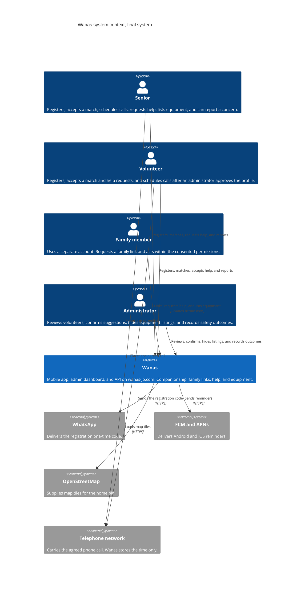

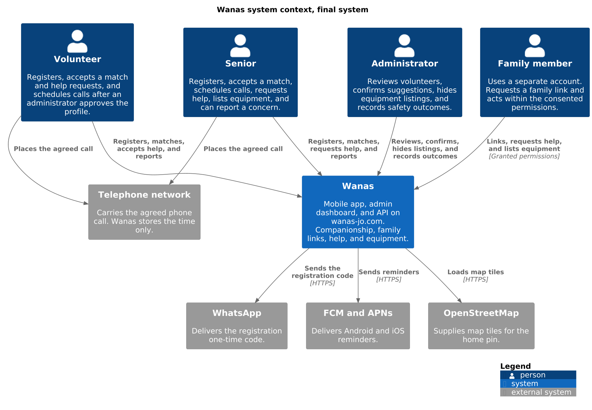

The four people talk to Wanas. Wanas talks to WhatsApp, to FCM and APNs, and to OpenStreetMap. The senior and the volunteer place the agreed call on the telephone network. Wanas keeps the agreed time, the family link, the help request, and the equipment listing.

## 3.4 External dependencies

| Neighbor | What crosses the boundary | What stays inside Wanas |
| --- | --- | --- |
| WhatsApp | A one-time registration code, sent to the person's phone number. | The account, the role, and the decision that the code matched. The phone number is not placed on a public profile. |
| FCM and APNs | A reminder for a scheduled call, addressed to that person's device. | The call row and the reminder status. A rejected push leaves the call scheduled, as Section 6 shows. |
| OpenStreetMap | Map tiles requested by the phone while the person places a home pin. | The saved coordinates. OpenStreetMap is a tile source, not an account system. Other people see the area name, not the pin. |
| Telephone network | The voice call between the senior and the volunteer at the agreed time. | The scheduled time, the match it belongs to, and the later status: completed, cancelled, or missed. |
| Google Play and the App Store | The published Android and iOS builds. | Nothing at runtime. Accounts, matches, and reports are not sent to either store. |

OVHcloud provides the single VPS. It is the place the system runs. Registration, matching, scheduling, help requests, and equipment listings stay inside Wanas.

## 3.5 Major interactions

1. A senior or volunteer asks Wanas for a registration code. Wanas stores the pending code and asks WhatsApp to deliver it. A matching code creates the account and removes the code. A wrong or expired code creates no account.
2. The mobile app loads OpenStreetMap tiles so the person can drop a home pin. The coordinates are saved on the profile inside Wanas.
3. Wanas reads the profiles and stores a suggestion. The suggestion stays inactive until the senior and the volunteer have both accepted it. An administrator confirms it before that acceptance is complete. A family member without permission cannot change the match.
4. On an active match, Wanas stores a call time. When the reminder is due, Wanas asks FCM or APNs to notify the phone. The two people then place the call on the telephone network.
5. A senior, a volunteer, or a family member with permission submits a safety report. An administrator reads it in the dashboard and records the outcome. The report and the outcome stay in Wanas.
6. A family member asks for a link to a senior. Wanas stores the link as pending. The senior approves or withdraws it and sets `CanCreateHelpRequest` and `CanViewSchedule`. The family member then acts only within those flags.
7. A senior, or a family member with `CanCreateHelpRequest`, creates a help request in one of the four everyday categories. Wanas stores it as open. An approved volunteer accepts it. A family member without that permission receives 403, and nothing is saved.
8. A person publishes an equipment listing and can add a photo. Another person arranges the handover. An administrator can hide the listing. The photo file stays on the VPS.

## 3.6 Scope of this context

This context covers accounts, profiles, family links, matching, scheduling, reminders, help requests, equipment listings, safety, and administration. Section 5 opens the box into the mobile app, the admin dashboard, the API, and PostgreSQL. Section 6 follows registration, match acceptance, the call reminder, and a help request through those parts.

## 3.7 References

- Section 1, for the four roles and the product scope. In-app chat and in-app voice or video stay outside this boundary.
- Section 2, especially TC-01, TC-05, TC-08, TC-09, TC-10, TC-11, OC-04, OC-05, and OC-06.
- Section 4, for the mobile app, the admin dashboard, WhatsApp, OpenStreetMap, and push.
- Section 6, for registration, match acceptance, the call reminder, and a help request.
- C4 model, system context diagram: https://c4model.com/diagrams/system-context
- arc42 Section 3, Context and Scope: https://docs.arc42.org/section-3/


# 4. Solution Strategy

| | |
| --- | --- |
| **Project** | Wanas (ونس) |
| **Document section** | arc42 — Section 4: Solution Strategy |
| **Status** | Draft for the final system |
| **Related section** | Section 2 records the limits. This section records the decisions that shape the final system inside those limits. |

This section describes the final Wanas system. Seniors, volunteers, and family members use one React Native app. Administrators use a separate Next.js dashboard. There is no website for seniors or volunteers. The API and the admin dashboard run on one OVHcloud VPS-1. The domain includes accounts, profiles, family links, matching, scheduling, notifications, help requests, equipment listings, safety, and administration.

## 4.1 Application type and responsibility split

Wanas is a mobile client for participants and a browser client for administrators, with one backend.

| Part | Responsibility |
| --- | --- |
| React Native app | One Android and iOS app for seniors, volunteers, and family members. Registration, profiles, family links, match suggestions, call scheduling, help requests, and equipment listings. Arabic and English, including right-to-left layout. Screens and local state only. |
| Next.js admin dashboard | A separate browser application. Administrators review volunteers, confirm suggestions, hide equipment listings, and handle safety reports. |
| C# monolith | Domain rules, the JSON API, Entity Framework, and the in-process worker. |
| PostgreSQL | Accounts, profiles, family links, matches, acceptances, schedules, notifications, help requests, equipment listings, and safety records. |
| Docker Compose on the VPS | Runs the admin dashboard, the monolith, and PostgreSQL on the single host from TC-01. |

The admin dashboard and the mobile app call one JSON API. Authorization, validation, and business rules stay in the monolith, as CV-03 and CV-06 require. A scheduled call is stored as an interaction. The phone call itself stays on the normal phone channel.

In-app chat and in-app voice or video stay outside this strategy.

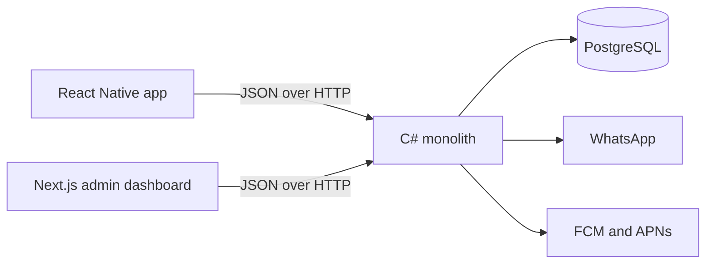

## 4.2 Architecture style

The backend is one monolithic .NET application. The host has 2 vCores and 4 GB RAM, so the deployable backend is one process. Microservices were set aside because they would spend that machine on network hops and extra processes.

### Clean architecture

The monolith is split into four layers:

| Layer | What it owns |
| --- | --- |
| Domain | Roles, consent, match acceptance, help requests, equipment listings, and the private home pin. |
| Application | Use cases that the API and the worker both call. |
| Infrastructure | Entity Framework Core, PostgreSQL, WhatsApp, push notifications, and uploaded files. |
| HTTP interface | The JSON API used by the Next.js admin dashboard and the React Native app. |

The domain does not reference Entity Framework, Next.js, or React Native. A change to a registration screen stays in the client. A change to a matching rule, a help request, or an equipment listing stays in the domain.

### Domain-driven design

The code uses the product language from CV-01: account, profile, match, interaction, consent, help request, equipment listing, and report. Those concepts are aggregates. The bounded contexts are modules inside the one deployable monolith:

| Bounded context | Responsibility |
| --- | --- |
| Accounts and access | Identity, roles, the family link and its consent, and the WhatsApp registration code. |
| Profiles | Interests, language, availability, and the private home pin. |
| Matching | Suggestions from shared interests, language, and area. An administrator confirms a proposed suggestion. It stays inactive until the senior and the volunteer have both accepted it. |
| Scheduling | Agreed call times and interaction status. |
| Help requests | Everyday requests in four categories, sent to the matched volunteer or to approved volunteers, then accepted or completed. |
| Equipment | Donate, lend, and request listings, their photos, and the handover. |
| Notifications | Reminders and mobile push. |
| Safety | Reports and the recorded outcome. |
| Administration | Volunteer review, match confirmation, and hiding an equipment listing. |

Matching can change without a change to registration or to notification delivery. A help-request change or an equipment change stays inside its own module. These modules share one database and one process.

## 4.3 Technology decisions

Each choice below is kept because of the advantage it gives Wanas and because it fits the rest of this system. Popularity is not the reason.

| Decision | Advantage for Wanas | Fit with the rest of the system | Alternative set aside |
| --- | --- | --- | --- |
| C# on .NET | One language holds the domain, the JSON API, Entity Framework, and the worker. | All of that runs as one process on the 4 GB VPS. | Node, Python, Java, or PHP for the backend. Node remains only in Next.js, which does not own the domain. |
| Clean architecture | Match acceptance, role checks, and the hidden home pin sit in the center. | Infrastructure and clients can change without rewriting those rules. | One undivided layer, where a screen change and a matching rule would be mixed. |
| Domain-driven design | The product names are already the code names. | Nine modules share one deployable application. | Extra services for each module. |
| Next.js | Administrators get a separate dashboard for review, confirmation, equipment listings, and safety reports. | The dashboard is a client of the same API. Seniors and volunteers do not use it. | Razor or Blazor inside the monolith, or a public website for seniors and volunteers. |
| React Native | Seniors, volunteers, and family members share one Android and iOS app. | That app calls the same JSON API. TC-12 already provides the store accounts used to publish it. | A separate Swift app and a separate Kotlin app, or a website for those three roles. |
| JSON over HTTP | The admin dashboard and the mobile app share one contract. | Authorization happens once, at the API boundary. | GraphQL or gRPC. |
| Entity Framework Core | It maps the companionship model onto PostgreSQL and produces the migrations used in CV-15. | It stays in the infrastructure layer. The domain does not reference it. | Dapper with hand-written SQL around the same aggregates. |
| In-process .NET worker | Reminders and push reuse the same use cases and the same database as the API. | The job stays inside the monolith’s migrations and configuration. | A second worker container, or a cron job on the host. |
| PostgreSQL | Matches, acceptances, roles, consent, help requests, and equipment listings are relational records. | The database runs beside the API on the VPS from TC-03. | A second database server. |
| Docker Compose on OVHcloud VPS-1 | The admin dashboard, the monolith, and PostgreSQL are one stack the team can operate. | It matches TC-01, TC-02, and CV-13. | More machines, or a managed database outside this host. |
| OpenStreetMap tiles in the mobile app | Seniors and volunteers drop a home pin during registration in the app so matching can use area. There is no map fee. | The pin is stored for matching and is omitted from public profiles, as TC-10 requires. | Google Maps, which would bill for the same pin and send the home location to another Google API. |
| WhatsApp for the registration code | The code reaches a phone seniors and volunteers already use. | The message contains a one-time code. The phone number stays off public profiles. | SMS through another telecom provider, or email as the only registration check. |
| Match suggestions inside the monolith | Shared interests, language, and map area are already on the profiles. | An administrator confirms the suggestion. It stays inactive until the senior and the volunteer accept it, as OC-06 requires. | A fully manual match with no suggestions, a suggestion that becomes active on its own, or a separate matching service. |

## 4.4 Clients and registration

Seniors, volunteers, and family members use the React Native app. Seniors and volunteers register there. Registration has two external steps:

1. WhatsApp sends a one-time code to the person’s phone. The monolith checks that code before the account becomes active.
2. The person places a home pin on a map that loads OpenStreetMap tiles. The coordinates are stored on the profile for area matching. The profile shown to other people withholds the exact home location and phone number.

Administrators do not use that app for their work. Their dashboard is a separate Next.js application for volunteer review, suggestion confirmation, equipment listings, and safety reports. Family members are a role inside the mobile app, with a consented link. They are not a separate deployable app, and they are not a separate bounded context in this strategy.

Help requests and equipment listings are part of this same app and the same monolith.

## 4.5 Third parties

| Third party | Role in the final system |
| --- | --- |
| OVHcloud | Hosts the single VPS-1. |
| Google | Google Play publishes the Android app. Firebase Cloud Messaging delivers Android push. |
| Apple | The App Store publishes the iOS app. Apple Push Notification service delivers iOS push. |
| WhatsApp | Sends the registration one-time code. |

OpenStreetMap provides the map tiles shown in the mobile app during registration. It is a tile source for the home pin, not an account system.

## 4.6 References

- Section 2, especially TC-01, TC-02, TC-03, TC-06, TC-07, TC-09, TC-10, TC-12, OC-06, CV-03, CV-06, CV-13, and CV-15.
- Section 1, for the product scope. In-app chat and in-app voice or video stay outside this strategy.
- arc42 Section 4, Solution Strategy: https://docs.arc42.org/section-4/


# 5. Building Block View

| | |
| --- | --- |
| **Project** | Wanas (ونس) |
| **Document section** | arc42 — Section 5: Building Block View |
| **Status** | Draft for the final system |
| **Diagrams** | C4 Container (Level 2) and C4 Component (Level 3) |

This section breaks the final Wanas system into the containers that run it, then opens the API into its internal components. Seniors, volunteers, and family members use one React Native app. Administrators use a separate Next.js dashboard. There is no website for seniors or volunteers.

The editable diagram sources are [diagrams/c4-container.mmd](diagrams/c4-container.mmd), [diagrams/c4-container.puml](diagrams/c4-container.puml), [diagrams/c4-component-api.mmd](diagrams/c4-component-api.mmd), and [diagrams/c4-component-api.puml](diagrams/c4-component-api.puml).

## 5.1 Why the system is split this way

The host is one OVHcloud VPS-1, so the server side is three containers: the admin dashboard, the C# monolith, and PostgreSQL. The mobile app is a fourth building block, installed from the stores, and it is not deployed on that machine. Business rules stay in the monolith. The app and the dashboard render screens and call one JSON API.

Help requests and equipment listings are modules inside the Wanas API. Equipment photos are files on a Docker volume on the same VPS. In-app chat and in-app voice or video are outside this view. A family member is a role in the mobile app, with a consented link.

## 5.2 Container view

### 5.2.1 C4 container diagram

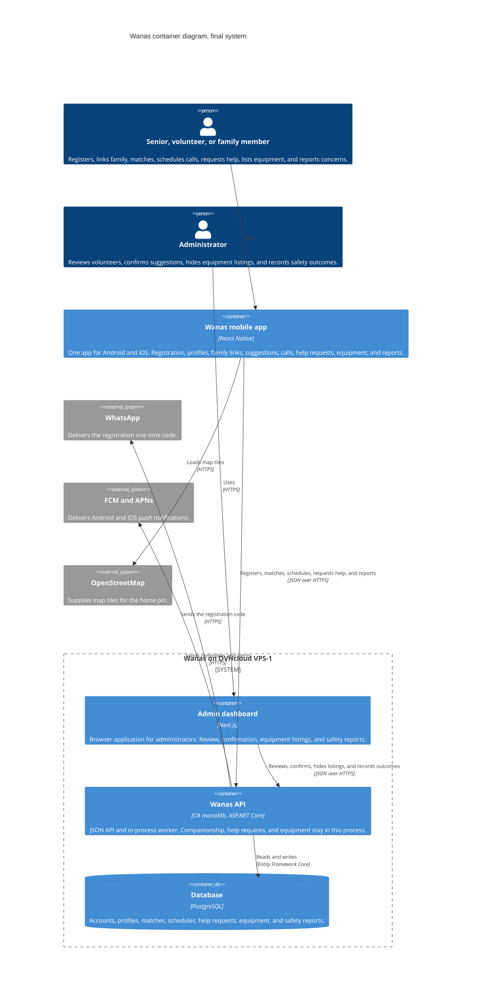

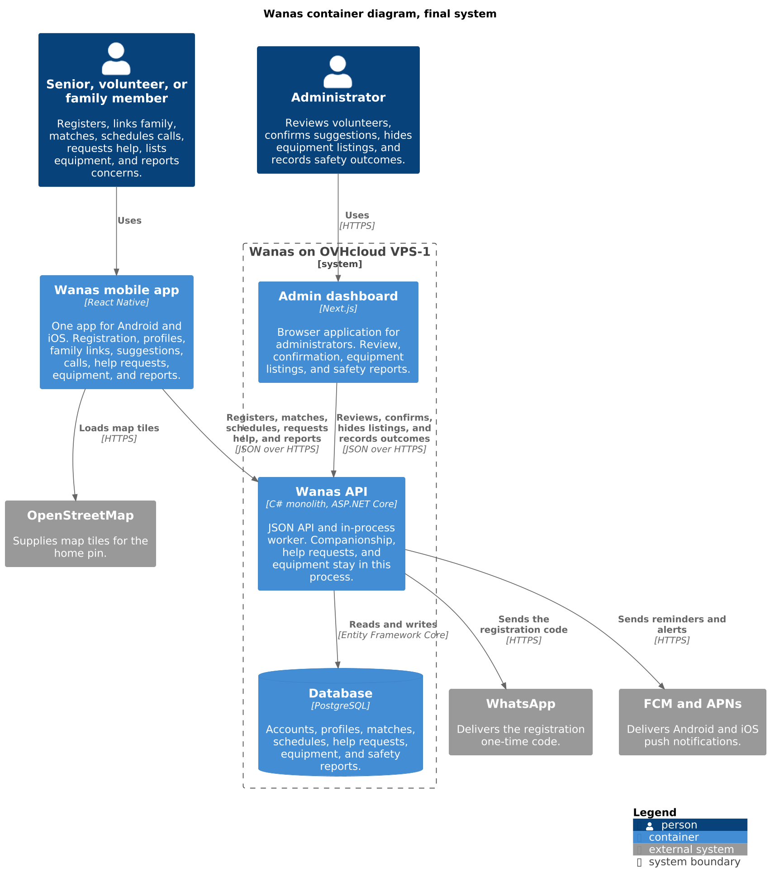

The mobile app sits outside the VPS boundary because it runs on the phone. The admin dashboard, the API, and PostgreSQL share the VPS and are started together with Docker Compose. PostgreSQL accepts connections only from the API on the Docker network. Public HTTPS on `wanas-jo.com` reaches the admin dashboard and the API.

The API box includes the in-process worker. That worker is not a second container. WhatsApp, FCM, and APNs are called by the API process. The phone loads OpenStreetMap tiles directly while the person places a home pin. The coordinates are then saved through the API. The exact pin and the phone number stay off public screens. Equipment photos sit on a Docker volume on the VPS. The API writes them, and PostgreSQL stores the photo row.

### 5.2.2 Containers

| Building block | Purpose | Responsibilities | Interface | Depends on |
| --- | --- | --- | --- | --- |
| Wanas mobile app | The only client for seniors, volunteers, and family members. | Arabic and English screens, including right-to-left layout. Registration, the home-pin map, profiles, family links, suggestion review, call scheduling, help requests, equipment listings, and safety reports. Holds local screen state. | JSON over HTTPS to the Wanas API. Map tiles over HTTPS from OpenStreetMap. Push received from FCM and APNs. | Wanas API, OpenStreetMap, the phone's push service. |
| Admin dashboard | The only browser application. | Volunteer review, suggestion confirmation, equipment-listing review, and the safety-report outcome. Administrator sign-in. | JSON over HTTPS to the Wanas API. | Wanas API. |
| Wanas API | The system of record and the rule engine. | Role checks, WhatsApp registration codes, profiles, family links, match suggestions, acceptance, schedules, reminders, push, help requests, equipment listings, and reports. | JSON over HTTPS for both clients. SQL to PostgreSQL. HTTPS to WhatsApp, FCM, and APNs. | PostgreSQL, the volume for equipment photos, WhatsApp, FCM, APNs. |
| PostgreSQL | Durable records for companionship, help requests, and equipment. | Stores accounts, profiles, family links, matches, acceptances, schedules, notifications, help requests, equipment rows, and safety reports. | SQL from the API, through Entity Framework Core. | The Docker volume on the VPS. |

Google Play and the App Store distribute the mobile app. They are not runtime containers.

## 5.3 Component view of the Wanas API

The API is the building block that holds the rules, so it is the one opened to components. The mobile app and the admin dashboard are thin clients and are left closed.

### 5.3.1 C4 component diagram

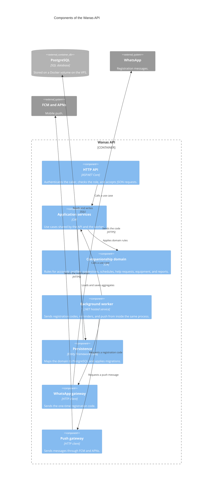

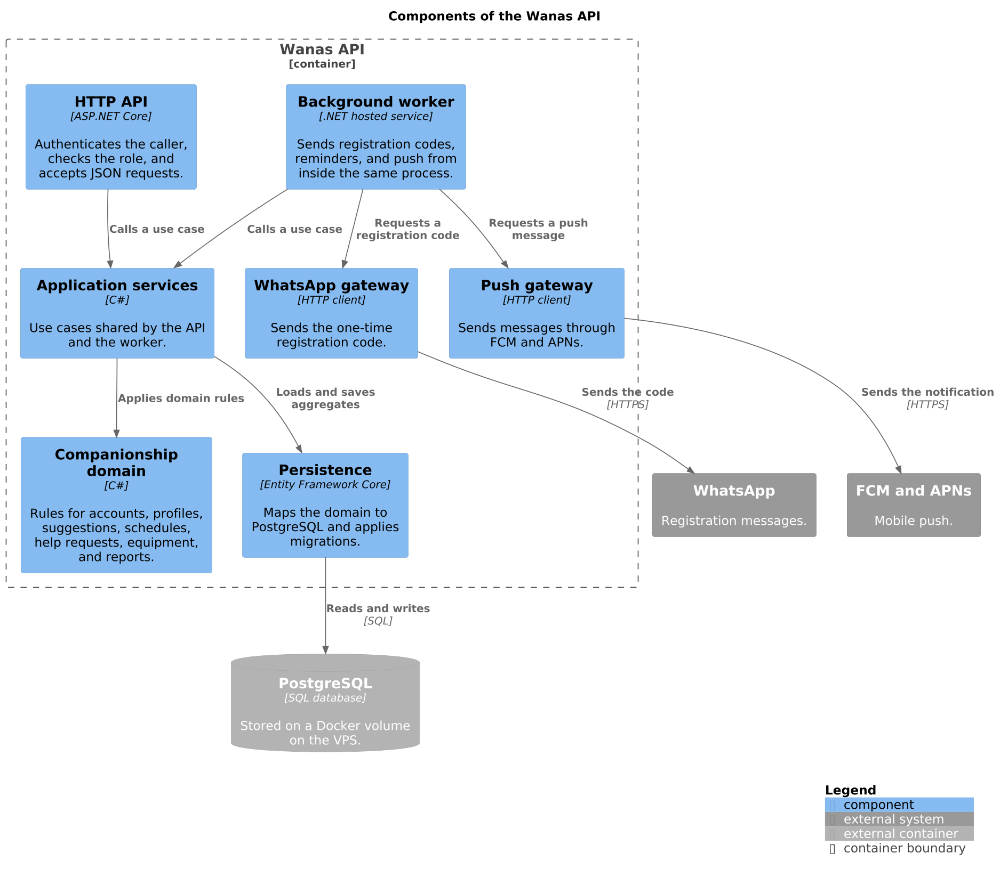

A request enters through the HTTP API, which rejects a caller who lacks the role. The application service runs one use case and asks the domain whether the action is allowed. Persistence reads and writes PostgreSQL. The worker uses the same application services, then asks the WhatsApp gateway or the push gateway to deliver a message. The domain does not call WhatsApp, the push networks, or Entity Framework.

### 5.3.2 Components

| Component | Purpose | Responsibilities | Interface | Depends on |
| --- | --- | --- | --- | --- |
| HTTP API | The door for both clients. | Authenticates the session, checks the role, validates the JSON shape, and returns a clear success or failure. | HTTPS JSON from the mobile app and the admin dashboard. Method calls into application services. | Application services. |
| Application services | One place for each user action. | Registration, profile update, family consent, suggestion, acceptance, scheduling, reminder dispatch, help requests, equipment listings, and safety reports. | Method calls from the HTTP API and the worker. | Companionship domain, persistence. |
| Companionship domain | The rules that must stay true. | Accounts and roles, private home pin, suggestions from interests, language, and area, acceptance before a match is active, schedules, help-request categories, equipment listings, and report outcomes. | Method calls from application services. | No infrastructure and no client. |
| Background worker | Timed and outbound work inside the API process. | Asks application services to issue a registration code, mark a reminder due, or prepare a push. | Method calls into application services, the WhatsApp gateway, and the push gateway. | Application services, WhatsApp gateway, push gateway. |
| Persistence | The PostgreSQL adapter. | Loads and saves aggregates. Applies migrations before the new API container serves traffic. Stores the equipment-photo row with its file key. | Method calls from application services. SQL to PostgreSQL. | PostgreSQL. |
| WhatsApp gateway | The registration-message adapter. | Sends the one-time code. Does not decide whether the account may be created. | Method call from the worker. HTTPS to WhatsApp. | WhatsApp. |
| Push gateway | The mobile-notification adapter. | Sends the prepared message to FCM or APNs. Does not decide who should be notified. | Method call from the worker. HTTPS to FCM and APNs. | FCM, APNs. |

Inside the companionship domain, the modules stay separate so a matching change does not require a registration or notification change:

| Module | Keeps |
| --- | --- |
| Accounts and access | The person, the role, the family link and its permissions, and the registration-code check. |
| Profiles | Interests, language, availability, and the private home pin. |
| Matching | A suggestion and the acceptance record. An administrator confirms it, and it stays inactive until the senior and the volunteer have both accepted. |
| Scheduling | The agreed call time and the interaction status. The phone call itself is placed outside Wanas. |
| Help requests | An everyday request in one of four categories, its audience, and the volunteer who accepted it. |
| Equipment | A donate, lend, or request listing, its photos, and the handover. |
| Notifications | The reminder and the push request. Delivery is left to the gateways. |
| Safety | The report and the outcome recorded by an administrator. |
| Administration | Volunteer review, confirmation of a suggestion, and hiding a listing. |

These modules are folders and types inside the domain component. They are not extra deployable services.

## 5.4 What is intentionally left out

The mobile app is not split into components here. Its screens change often, and they do not own rules. The admin dashboard is the same kind of client, limited to administrator actions. A second component diagram for either client would repeat the API's use cases.

In-app chat and in-app voice or video are outside this view. Help requests and equipment listings are modules inside the Wanas API.

## 5.5 References

- Section 4, for the monolith, clean architecture, domain-driven design, and the technology choices.
- Section 2, especially TC-01, TC-02, TC-03, TC-07, TC-10, TC-11, CV-06, CV-07, and CV-11.
- Section 1, for the roles and the product scope.
- C4 model: https://c4model.com/
- arc42 Section 5, Building Block View: https://docs.arc42.org/section-5/


# 6. Runtime View

| | |
| --- | --- |
| **Project** | Wanas (ونس) |
| **Document section** | arc42 — Section 6: Runtime View |
| **Status** | Draft for the final system |
| **Diagrams** | Four sequence diagrams |

Each diagram uses the mobile app or the admin dashboard, the Wanas API, PostgreSQL, and one outside service when a message leaves the server. The API box stands for the HTTP entry point, the domain rules, and the in-process worker from Section 5.

The pictures and their editable sources are in [diagrams](diagrams/).

## 6.1 Registration and authorization

A senior or volunteer creates an account in the mobile app. WhatsApp carries the one-time code. A later administrator request with that same token is refused.

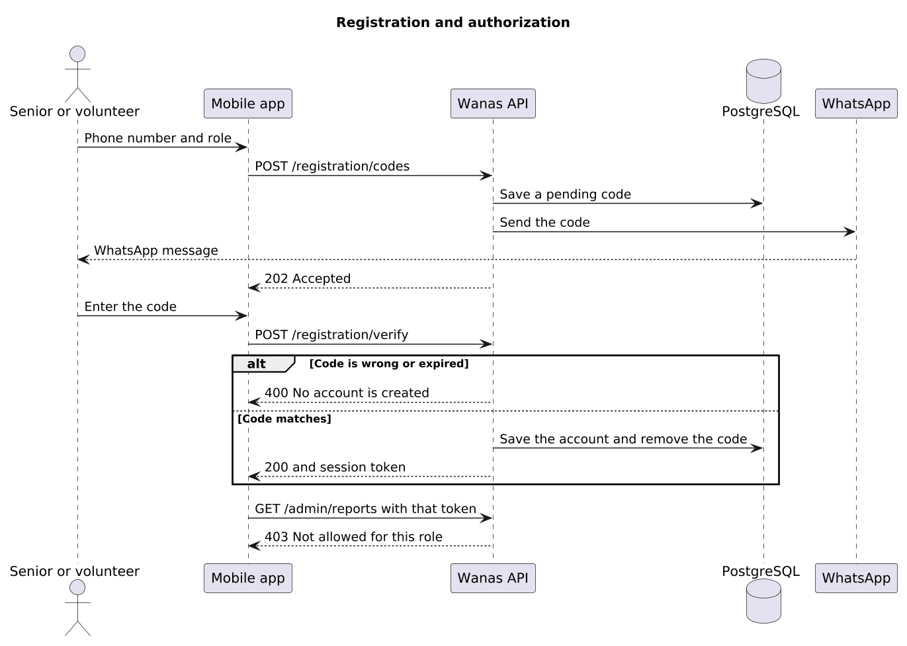

| What happens | Result |
| --- | --- |
| The app asks for a code. | The API stores a pending code and WhatsApp delivers it. The response is `202`. |
| The code is wrong or expired. | The API answers `400`. No account is stored. |
| The code matches. | The API stores the account with its role, removes the code, and returns a session token. |
| The app calls an administrator route with that token. | The API answers `403`. No report data is read. |

## 6.2 Match suggestion and acceptance

A suggestion starts inactive. It becomes an active match only after the senior and the volunteer have both accepted.

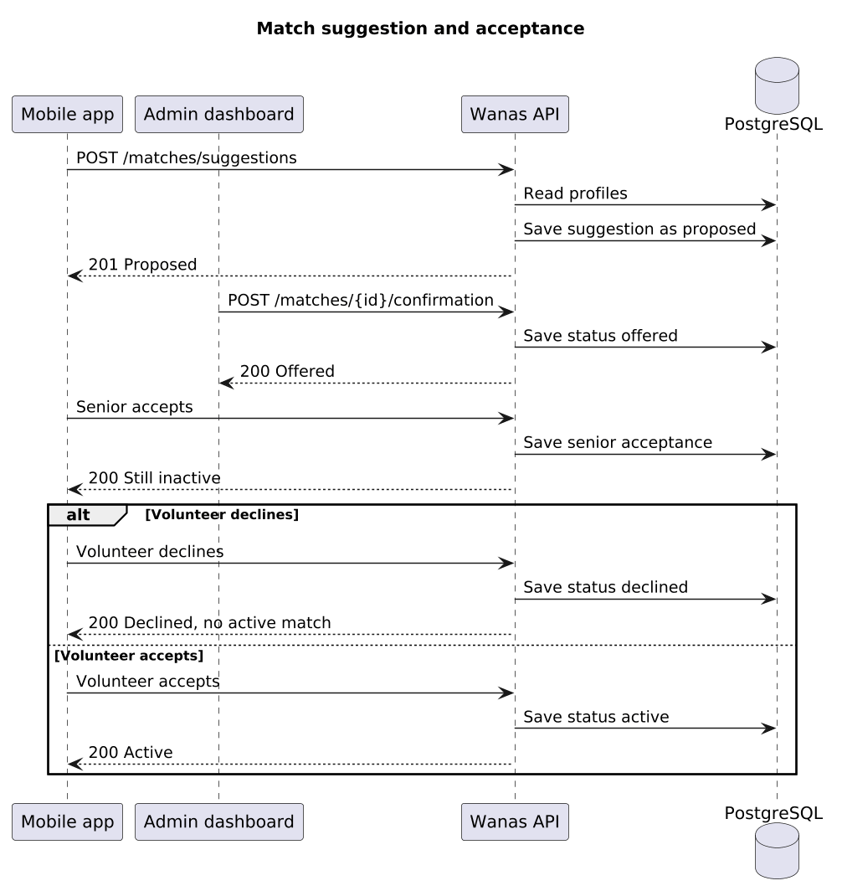

| What happens | Result |
| --- | --- |
| The app asks for a suggestion. | The API reads the profiles and stores a suggestion as `proposed`. |
| An administrator confirms it. | The status becomes `offered`. The people still have to accept. |
| The senior accepts. | The acceptance is stored. The match stays inactive. |
| The volunteer declines. | The status becomes `declined`. There is no active match. |
| The volunteer accepts. | The status becomes `active`. |

A family member without permission receives `403`, and the match row is left as it is.

## 6.3 Schedule a call and send the reminder

A call time can be saved only for an active match. The phone call itself stays on the normal phone. The API sends the reminder through FCM or APNs.

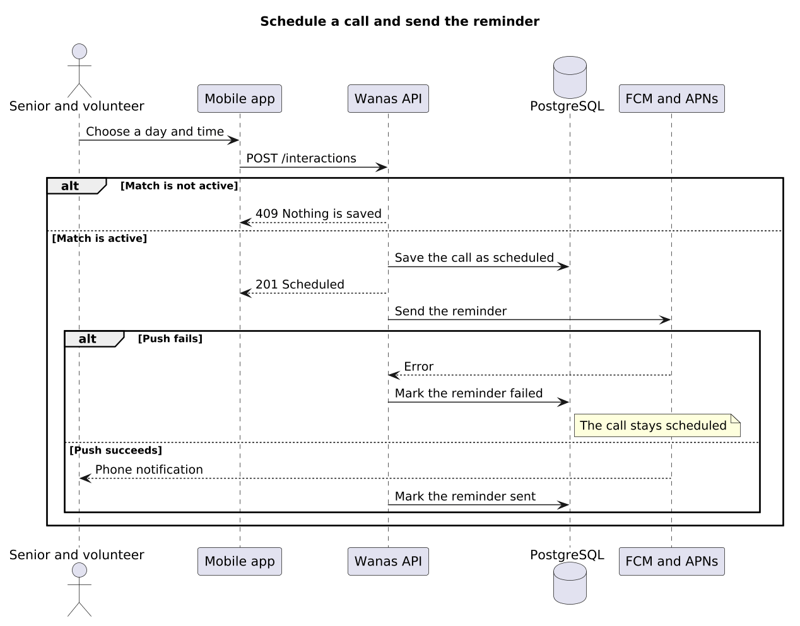

| What happens | Result |
| --- | --- |
| The match is not active. | The API answers `409`. Nothing is saved. |
| The match is active. | The API stores the call as `scheduled` and answers `201`. |
| The push service rejects the reminder. | The reminder is marked failed. The call stays `scheduled`. |
| The push service accepts it. | The phone shows the notification, and the reminder is marked sent. |

## 6.4 Create and accept a help request

A senior, or a family member with `CanCreateHelpRequest`, creates an everyday help request. An approved volunteer accepts it. A family member without that permission is refused.

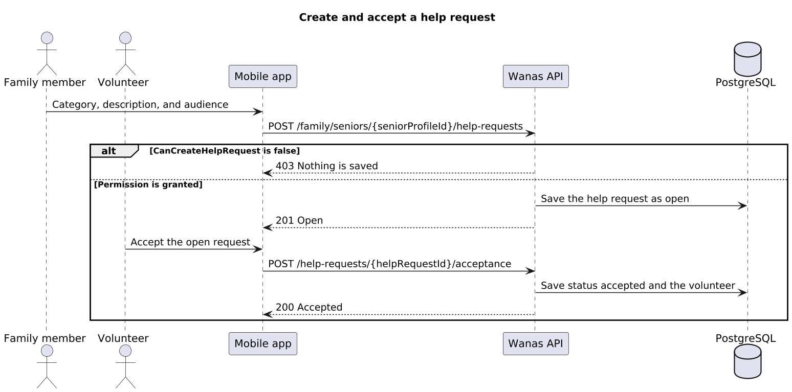

| What happens | Result |
| --- | --- |
| A family member without `CanCreateHelpRequest` submits a help request. | The API answers `403`. Nothing is saved. |
| A senior creates a request, or a family member has approved consent and `CanCreateHelpRequest`. | The API stores the request as `open` and answers `201`. |
| An approved volunteer accepts the open request. | The status becomes `accepted`. The row stores that volunteer. |

The category is grocery shopping, transportation or accompaniment, technology help, or a small errand.

## 6.5 References

- Section 5, for the mobile app, the admin dashboard, the API, and PostgreSQL.
- Section 4, for WhatsApp registration, match acceptance, and push reminders.
- Diagram sources: [diagrams/sequence-registration.puml](diagrams/sequence-registration.puml), [diagrams/sequence-match-acceptance.puml](diagrams/sequence-match-acceptance.puml), [diagrams/sequence-call-reminder.puml](diagrams/sequence-call-reminder.puml), and [diagrams/sequence-help-request.puml](diagrams/sequence-help-request.puml).
- arc42 Section 6, Runtime View: https://docs.arc42.org/section-6/


# 7. Data Architecture

| | |
| --- | --- |
| **Project** | Wanas (ونس) |
| **Document section** | arc42 — Section 7: Data Architecture |
| **Status** | Draft for the final system |
| **Database** | PostgreSQL, mapped with Entity Framework Core |

Wanas stores companionship, schedules, help requests, and equipment listings in one PostgreSQL database on the OVHcloud VPS. Entity Framework Core maps these tables and runs the migrations before a new API container starts. A relational database fits the rules below: one senior has one volunteer, one volunteer can support many seniors, and a call, a help request, or an equipment handover always points at a known person.

The picture and its source are [diagrams/erd.png](diagrams/erd.png) and [diagrams/erd.puml](diagrams/erd.puml).

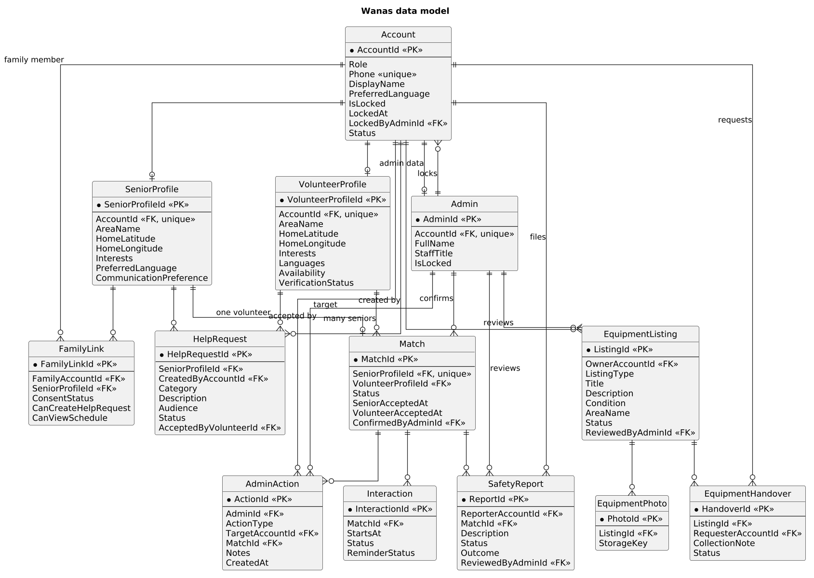

## 7.1 Why this database

PostgreSQL keeps accounts, matches, schedules, requests, and listings as separate tables with foreign keys. That matches the requirement to keep those concepts separate, and it can express "one current volunteer per senior" as a unique key. The database runs in a container beside the API, which is the one-machine limit from Section 2. Entity Framework Core stays in the infrastructure layer, so the domain rules do not depend on the table layout.

## 7.2 Main entities

Primary keys are `uuid`. `Account.Phone` is unique. `Match.SeniorProfileId` is unique, so a senior row points at one match and therefore one volunteer. `Match.VolunteerProfileId` is not unique, so that volunteer can appear on many seniors' matches.

| Entity | Primary key | Foreign keys | What it stores |
| --- | --- | --- | --- |
| Account | AccountId | LockedByAdminId → Admin | Every login: senior, volunteer, family member, or administrator. `IsLocked` stops the account. |
| Admin | AdminId | AccountId → Account, unique | Staff data for an administrator: full name, title, and `IsLocked` on the staff record. |
| SeniorProfile | SeniorProfileId | AccountId → Account, unique | Area, private home pin, interests, language, and communication preference. |
| VolunteerProfile | VolunteerProfileId | AccountId → Account, unique | Area, private home pin, interests, languages, availability, and verification status. |
| FamilyLink | FamilyLinkId | FamilyAccountId → Account, SeniorProfileId → SeniorProfile | Consent and the permissions granted to one family member for one senior. |
| Match | MatchId | SeniorProfileId → SeniorProfile, unique; VolunteerProfileId → VolunteerProfile; ConfirmedByAdminId → Admin | The one volunteer linked to a senior, plus both acceptance times. |
| Interaction | InteractionId | MatchId → Match | A scheduled call: start time, status, and reminder status. |
| HelpRequest | HelpRequestId | SeniorProfileId → SeniorProfile; CreatedByAccountId → Account; AcceptedByVolunteerId → VolunteerProfile | An everyday help request and the volunteer who accepted it. |
| EquipmentListing | ListingId | OwnerAccountId → Account; ReviewedByAdminId → Admin | A donate, lend, or request listing. |
| EquipmentPhoto | PhotoId | ListingId → EquipmentListing | A stored photo for a listing. |
| EquipmentHandover | HandoverId | ListingId → EquipmentListing; RequesterAccountId → Account | The collection arrangement for an item. |
| SafetyReport | ReportId | ReporterAccountId → Account; MatchId → Match; ReviewedByAdminId → Admin | A concern and the outcome an administrator recorded. |
| AdminAction | ActionId | AdminId → Admin; TargetAccountId → Account; MatchId → Match | A lock, an unlock, a rematch, or another important staff action. |

Home latitude and longitude stay on the profile. A response about another person returns `areaName` and a display name. The exact home pin and the phone number stay on the stored row.

### Columns

These are the columns for each entity. Primary keys are `uuid`.

#### Account

| Column | Rule |
| --- | --- |
| AccountId | Primary key. |
| Role | Senior, Volunteer, Family, or Admin. |
| Phone | Unique. |
| DisplayName | The name returned with another person's `areaName`. |
| PreferredLanguage | `ar` or `en`. |
| IsLocked | When true, sign-in stops. |
| LockedAt | Required when `IsLocked` is true. Empty when `IsLocked` is false. |
| LockedByAdminId | Foreign key to Admin. Required when locked. Empty when unlocked. |
| Status | Stored on the account row. |

#### Admin

| Column | Rule |
| --- | --- |
| AdminId | Primary key. |
| AccountId | Foreign key to Account. Unique. The account role is Admin. |
| FullName | The administrator's full name. |
| StaffTitle | The staff title. |
| IsLocked | Lock on the staff record. Set to the same value as the account lock. |

#### SeniorProfile

| Column | Rule |
| --- | --- |
| SeniorProfileId | Primary key. |
| AccountId | Foreign key to Account. Unique. |
| AreaName | Returned to other people as `areaName`. |
| HomeLatitude | Private home pin. Returned on `GET /me` for this senior. |
| HomeLongitude | Private home pin. Returned on `GET /me` for this senior. |
| Interests | Used when choosing a suggestion. |
| PreferredLanguage | `ar` or `en`. |
| CommunicationPreference | `phone` or `visit`. |

#### VolunteerProfile

| Column | Rule |
| --- | --- |
| VolunteerProfileId | Primary key. |
| AccountId | Foreign key to Account. Unique. |
| AreaName | Returned to other people as `areaName`. |
| HomeLatitude | Private home pin. Returned on `GET /me` for this volunteer. |
| HomeLongitude | Private home pin. Returned on `GET /me` for this volunteer. |
| Interests | Used when choosing a suggestion. |
| Languages | `ar`, `en`, or both. |
| Availability | `weekday_mornings`, `weekday_evenings`, or `weekends`. |
| VerificationStatus | Pending, Approved, or Rejected. |

#### FamilyLink

| Column | Rule |
| --- | --- |
| FamilyLinkId | Primary key. |
| FamilyAccountId | Foreign key to Account. |
| SeniorProfileId | Foreign key to SeniorProfile. |
| ConsentStatus | Pending, Approved, or Revoked. |
| CanCreateHelpRequest | True when this family member may create a help request. |
| CanViewSchedule | True when this family member may view and schedule calls. |

#### Match

| Column | Rule |
| --- | --- |
| MatchId | Primary key. |
| SeniorProfileId | Foreign key to SeniorProfile. Unique, so the senior has one current match. |
| VolunteerProfileId | Foreign key to VolunteerProfile. The same volunteer can appear on many seniors' matches. |
| Status | Proposed, Offered, Active, Declined, or Ended. |
| SeniorAcceptedAt | Set when the senior accepts. |
| VolunteerAcceptedAt | Set when the volunteer accepts. |
| ConfirmedByAdminId | Foreign key to Admin. Required when the status is Offered or Active. |

#### Interaction

| Column | Rule |
| --- | --- |
| InteractionId | Primary key. |
| MatchId | Foreign key to Match. |
| StartsAt | The agreed call time. |
| Status | Scheduled, Completed, Cancelled, or Missed. |
| ReminderStatus | `pending`, `sent`, or `failed`. |

#### HelpRequest

| Column | Rule |
| --- | --- |
| HelpRequestId | Primary key. |
| SeniorProfileId | Foreign key to SeniorProfile. |
| CreatedByAccountId | Foreign key to Account. The senior, or the family member who created the request. |
| Category | `grocery`, `transportation`, `technology`, or `errand`. |
| Description | What the requester needs. |
| Audience | `matched_volunteer` or `approved_volunteers`. |
| Status | Open, Accepted, Completed, or Cancelled. |
| AcceptedByVolunteerId | Foreign key to VolunteerProfile. Required when the status is Accepted or Completed. |

#### EquipmentListing

| Column | Rule |
| --- | --- |
| ListingId | Primary key. |
| OwnerAccountId | Foreign key to Account. |
| ListingType | `donate`, `lend`, or `request`. |
| Title | The item name. |
| Description | The item description. |
| Condition | `new`, `good`, or `fair`. |
| AreaName | The area shown for the item. |
| Status | Available, Reserved, Collected, Transferred, or Unavailable. |
| ReviewedByAdminId | Foreign key to Admin. Set when an administrator hides the listing. |

#### EquipmentPhoto

| Column | Rule |
| --- | --- |
| PhotoId | Primary key. |
| ListingId | Foreign key to EquipmentListing. |
| StorageKey | The file key for the photo stored on the VPS. |

#### EquipmentHandover

| Column | Rule |
| --- | --- |
| HandoverId | Primary key. |
| ListingId | Foreign key to EquipmentListing. |
| RequesterAccountId | Foreign key to Account. The person arranging collection. |
| CollectionNote | The agreed collection note. |
| Status | `arranged` when the handover is recorded. |

#### SafetyReport

| Column | Rule |
| --- | --- |
| ReportId | Primary key. |
| ReporterAccountId | Foreign key to Account. |
| MatchId | Foreign key to Match. |
| Description | The concern. |
| Status | Open until an outcome is stored, then closed. |
| Outcome | `no_action`, `warning_sent`, `match_ended`, or `account_locked`. |
| ReviewedByAdminId | Foreign key to Admin. |

#### AdminAction

| Column | Rule |
| --- | --- |
| ActionId | Primary key. |
| AdminId | Foreign key to Admin. |
| ActionType | The staff action: a lock, an unlock, a rematch, a hidden listing, or a report outcome. |
| TargetAccountId | Foreign key to Account. |
| MatchId | Foreign key to Match. |
| Notes | The note stored with the action. |
| CreatedAt | When the action was stored. |

## 7.3 Relationships

| From | To | Cardinality | Rule |
| --- | --- | --- | --- |
| Account | SeniorProfile | One to zero or one | Only a senior account has a senior profile. |
| Account | VolunteerProfile | One to zero or one | Only a volunteer account has a volunteer profile. |
| Account | Admin | One to zero or one | Only an administrator account has admin data. |
| SeniorProfile | FamilyLink | One to many | A senior may grant access to more than one family member. |
| SeniorProfile | Match | One to zero or one | A senior has one volunteer. |
| VolunteerProfile | Match | One to many | A volunteer can be the match for many seniors. |
| Match | Interaction | One to many | One match has many scheduled calls. |
| SeniorProfile | HelpRequest | One to many | A senior can have many help requests. |
| VolunteerProfile | HelpRequest | One to many | A volunteer can accept many requests, including requests from several seniors. |
| Account | EquipmentListing | One to many | A person can publish many listings. |
| EquipmentListing | EquipmentPhoto | One to many | A listing can have several photos. |
| EquipmentListing | EquipmentHandover | One to many | Collection is recorded separately from the listing text. |
| Account | SafetyReport | One to many | A person can file more than one report. |
| Admin | Account | One to many | An administrator locks and unlocks accounts. |
| Admin | AdminAction | One to many | Staff actions stay with the administrator who took them. |

## 7.4 Constraints and validation

| Rule | How it is enforced |
| --- | --- |
| Role is Senior, Volunteer, Family, or Admin. | Check on `Account.Role`. |
| A locked account records when and which administrator locked it. | `IsLocked = true` requires `LockedAt` and `LockedByAdminId`. |
| An unlocked account has no lock stamp. | `IsLocked = false` requires `LockedAt` and `LockedByAdminId` to be empty. |
| Admin staff data belongs to an administrator account. | `Admin.AccountId` is unique, and that account's role is Admin. |
| A senior has one match row. | Unique `Match.SeniorProfileId`. |
| An active match has both acceptances. | `Status = Active` requires `SeniorAcceptedAt` and `VolunteerAcceptedAt`. |
| A confirmed match names the administrator. | `Status` of Offered or Active requires `ConfirmedByAdminId`. |
| Call status is Scheduled, Completed, Cancelled, or Missed. | Check on `Interaction.Status`. |
| A call is scheduled only for an active match. | The API reads `Match.Status` before inserting an interaction. |
| Help category is grocery shopping, transportation or accompaniment, technology help, or a small errand. | Check on `HelpRequest.Category`. Medical care, medication, money, and emergencies are not values in that list. |
| Help status is Open, Accepted, Completed, or Cancelled. | Check on `HelpRequest.Status`. |
| An accepted help request names a volunteer. | `Status = Accepted` or `Completed` requires `AcceptedByVolunteerId`. |
| A family member creates a help request only with consent and that permission. | `FamilyLink.ConsentStatus = Approved` and `CanCreateHelpRequest = true`. |
| Listing type is Donate, Lend, or Request. | Check on `EquipmentListing.ListingType`. |
| Listing status is Available, Reserved, Collected, Transferred, or Unavailable. | Check on `EquipmentListing.Status`. |
| The exact home pin and phone number are not public fields. | They live on `Account` and the profile. Profile responses used by other people return `AreaName` only. |

`Match.Status` moves from Proposed, to Offered, to Active, or to Declined or Ended. Volunteer verification is Pending, Approved, or Rejected. A volunteer enters matching only after Approved.

## 7.5 Ownership and lifecycle

| Data | Owner | Lifecycle |
| --- | --- | --- |
| Account and `IsLocked` | The person owns the profile facts. An administrator owns the lock. | Created at registration. A lock keeps the rows and blocks sign-in. Unlock clears `LockedAt` and `LockedByAdminId`. |
| Admin | The staff record. | Created when an administrator account is added. `Admin.IsLocked` blocks that staff user without deleting the record. |
| Senior and volunteer profiles | The account holder. | Updated by that person. The home pin is replaced only by that person. |
| FamilyLink | The senior, through consent. | Stays until the senior withdraws it. Withdrawal sets consent to Revoked and clears the permission flags. |
| Match | The senior, the volunteer, and the confirming administrator. | One row per senior. Ending it sets Status to Ended and writes an `AdminAction`. A later volunteer replaces `VolunteerProfileId` only after both new acceptances. |
| Interaction | The matched pair. | Scheduled, then Completed, Cancelled, or Missed. The row remains. |
| HelpRequest | The senior. A family member with permission may create it. | Open, Accepted, Completed, or Cancelled. |
| Equipment listing, photos, and handover | The listing owner and the requester. An administrator may hide it. | Status follows the item from Available through collection. Hiding sets Unavailable and writes an `AdminAction`. |
| SafetyReport | The reporter. The reviewing administrator owns the outcome. | Open until an outcome is stored. |
| AdminAction | The administrator who acted. | Inserted once and kept. |

A registration code is temporary. It is stored only until it is used or expires, then deleted. It is not a lasting entity on the diagram.

## 7.6 Integrity and consistency

Foreign keys stop a match, a call, a help request, or a listing from pointing at a missing person. Deleting an account is not a normal action. Locking it leaves the historical rows in place.

The unique senior key and the acceptance check keep the companionship rule in the database, not only in a screen. One volunteer still has many match rows because the unique key is on the senior, not on the volunteer.

Help requests and equipment are in this model so those records have owners and statuses. A help request cannot name a category outside the four everyday tasks. An equipment item cannot skip from Available to Transferred without a handover row.

`AdminAction` is the consistency record for locks, ended matches, hidden listings, and report outcomes. The report row holds the outcome. The action row holds who changed it and when.

## 7.7 How this supports the system

The model gives a senior one volunteer and lets that volunteer be matched with other seniors. Calls hang off that match, so a schedule exists only for a real pair. Help requests hang off the senior and can name the matched volunteer or stay open for an approved volunteer. Equipment listings hang off the owner, with photos and a recorded collection. `IsLocked` on `Account`, `IsLocked` on `Admin`, and `LockedByAdminId` give administrators a lock without removing the person's data. `AdminAction` keeps the staff record the assignment asks for.

Private coordinates and phone numbers have columns, and the public read path does not return them. That is the same privacy rule as Section 2 and Section 4.

## 7.8 References

- Section 1, especially profiles, matching, scheduling, Helping Hands, Community Exchange, and administration.
- Section 2, for PostgreSQL, separate concepts, and private contact details.
- Section 4, for Entity Framework Core and match acceptance.
- Section 6, for the registration, match, reminder, and help-request writes.
- Diagram source: [diagrams/erd.puml](diagrams/erd.puml).


# 8. API Design and Communication

| | |
| --- | --- |
| **Project** | Wanas (ونس) |
| **Document section** | arc42 — Section 8: API Design and Communication |
| **Status** | Draft for the final system |
| **Style** | JSON over HTTPS |

The mobile app and the admin dashboard call one API at `https://wanas-jo.com/api`. Every path below is relative to that base. A signed-in request sends `Authorization: Bearer <token>`.

The token carries one role: `Senior`, `Volunteer`, `Family`, or `Admin`. A call listed under another role returns `403` with `"error": "forbidden"`. A locked account returns `403` with `"error": "account_locked"`. Both leave stored rows unchanged.

Every error body has the same shape:

```json
{ "error": "invalid_code" }
```

These results apply to every signed-in call, so the tables below list only the extra checks for that call.

| Situation | Result |
| --- | --- |
| The token is missing or not valid. | `401` `unauthorized` |
| The account is locked. | `403` `account_locked` |
| The role, or the link permission, does not allow this call. | `403` `forbidden` |

A response about the caller may include that caller's own phone number and home pin. A response about another person includes `areaName` and a display name only.

## 8.1 Shared sign-in

Seniors, volunteers, and family members create their own account with the same two calls. The `role` in the body decides which account is created. An administrator does not use these calls. Staff sign-in is in [8.5](#85-administrator).

### 8.1.1 Request a registration code

| | |
| --- | --- |
| **Method and path** | `POST /registration/codes` |
| **Authentication** | None. |
| **Who** | A person registering as a senior, a volunteer, or a family member. |

Request body:

```json
{
  "phone": "+962790000000",
  "role": "Senior",
  "displayName": "Layla Hassan",
  "preferredLanguage": "ar"
}
```

`role` is `Senior`, `Volunteer`, or `Family`. `preferredLanguage` is `ar` or `en`.

Success, `202 Accepted`:

```json
{ "status": "code_sent" }
```

The API stores a pending code and asks WhatsApp to deliver it. The response does not contain the code.

| Check | Error |
| --- | --- |
| `phone` is missing or not a phone number. | `400` `invalid_phone` |
| `role` is missing or not one of the three mobile roles. | `400` `invalid_role` |
| `displayName` is missing, or `preferredLanguage` is not `ar` or `en`. | `400` `invalid_account` |
| The phone already has an account. | `409` `phone_taken` |
| WhatsApp does not accept the message. | `502` `whatsapp_unavailable`. The pending code is removed. |

### 8.1.2 Verify the code

| | |
| --- | --- |
| **Method and path** | `POST /registration/verify` |
| **Authentication** | None. The code is the proof. |

Request body:

```json
{
  "phone": "+962790000000",
  "code": "482193"
}
```

Success, `200 OK`:

```json
{
  "accountId": "3a1b2c4d-5e6f-4a7b-8c9d-0e1f2a3b4c5d",
  "role": "Senior",
  "token": "session-token"
}
```

The API stores the account with that role, removes the used code, and returns the session token. A senior or volunteer still needs a profile before matching. A family member still needs an approved link before acting for a senior.

| Check | Error |
| --- | --- |
| The phone or the code is missing. | `400` `invalid_code` |
| The code is wrong or expired. | `400` `invalid_code`. No account is stored. |
| The phone already completed registration. | `409` `phone_taken` |

## 8.2 Senior

A senior token updates one senior profile, decides family consent, holds one match, schedules calls on that match, asks for everyday help, lists equipment, and files a safety report.

| Method | Path | What it does |
| --- | --- | --- |
| GET | `/me` | Returns the senior account, profile, and home pin. |
| PUT | `/profiles/senior` | Creates or replaces the senior profile. |
| GET | `/family-links` | Lists family members waiting for consent or already linked. |
| POST | `/family-links/{familyLinkId}/consent` | Approves or withdraws a family link and sets the two permissions. |
| POST | `/matches/suggestions` | Asks the system for the senior's one volunteer suggestion. |
| GET | `/matches/mine` | Returns that one match, without the volunteer's phone or home pin. |
| POST | `/matches/{matchId}/acceptances` | Accepts or declines the offered match. |
| GET | `/interactions` | Lists calls on the senior's match. |
| POST | `/interactions` | Schedules a call on an active match. |
| PATCH | `/interactions/{interactionId}` | Cancels or reschedules a scheduled call. |
| POST | `/help-requests` | Creates an everyday help request. |
| GET | `/help-requests` | Lists the senior's help requests and their status. |
| POST | `/help-requests/{helpRequestId}/cancellation` | Cancels an open or accepted request. |
| POST | `/equipment-listings` | Publishes a donate, lend, or request listing. |
| POST | `/equipment-listings/{listingId}/photos` | Adds one photo to the caller's own listing. |
| GET | `/equipment-listings` | Lists available equipment. Another owner's phone is omitted. |
| POST | `/reports` | Files a safety report about the senior's match. |

### 8.2.1 Update the senior profile

| | |
| --- | --- |
| **Method and path** | `PUT /profiles/senior` |
| **Authentication** | Bearer token with role `Senior`. |

Request body:

```json
{
  "areaName": "Jabal Amman",
  "homeLatitude": 31.9539,
  "homeLongitude": 35.9106,
  "interests": ["reading", "walking"],
  "preferredLanguage": "ar",
  "communicationPreference": "phone"
}
```

`communicationPreference` is `phone` or `visit`. The home pin is stored on `SeniorProfile` and is returned only by `GET /me` for this senior.

Success, `200 OK`:

```json
{
  "seniorProfileId": "aa11bb22-cc33-4d44-8e55-ff6677889900",
  "areaName": "Jabal Amman",
  "preferredLanguage": "ar",
  "communicationPreference": "phone"
}
```

| Check | Error |
| --- | --- |
| A required field is missing, the language is not `ar` or `en`, or the pin is outside a usable latitude and longitude. | `400` `invalid_profile` |
| `communicationPreference` is not `phone` or `visit`. | `400` `invalid_profile` |

### 8.2.2 Decide a family link

| | |
| --- | --- |
| **Method and path** | `POST /family-links/{familyLinkId}/consent` |
| **Authentication** | Bearer token with role `Senior`. The link must point at this senior's profile. |

Request body for approval:

```json
{
  "decision": "approve",
  "canCreateHelpRequest": true,
  "canViewSchedule": true
}
```

`decision` is `approve` or `revoke`. Approval sets `ConsentStatus` to `Approved` and stores the two flags. Revoke sets `ConsentStatus` to `Revoked` and clears both flags. The family member keeps their own account.

Success, `200 OK`:

```json
{
  "familyLinkId": "c1d2e3f4-a5b6-4c7d-8e9f-001122334455",
  "consentStatus": "Approved",
  "canCreateHelpRequest": true,
  "canViewSchedule": true
}
```

The response names the family member by display name and omits their phone number.

| Check | Error |
| --- | --- |
| `decision` is missing, or a permission flag is missing on approval. | `400` `invalid_consent` |
| No link has this id, or the link belongs to another senior. | `404` `link_not_found` |
| The link is already revoked and the decision is `approve` after revoke. A new request from the family member is required. | `409` `link_revoked` |

### 8.2.3 Ask for a match suggestion

| | |
| --- | --- |
| **Method and path** | `POST /matches/suggestions` |
| **Authentication** | Bearer token with role `Senior`. |
| **Request body** | Empty. The API reads this senior's profile. |

The API chooses one approved volunteer using shared interests, language, and area. It stores one `Match` row with status `proposed`. A senior has one match row, so a later suggestion after `ended` or `declined` replaces `VolunteerProfileId` on that same row and clears both acceptance times.

Success, `201 Created`:

```json
{
  "matchId": "6f1c0a2e-7b4d-4e1a-9c33-1a2b3c4d5e6f",
  "status": "proposed",
  "volunteer": {
    "displayName": "Omar Nasser",
    "areaName": "Jabal Amman"
  }
}
```

| Check | Error |
| --- | --- |
| The senior has no profile yet. | `409` `profile_required` |
| The current match is `proposed`, `offered`, or `active`. | `409` `match_exists` |
| No approved volunteer fits interests, language, and area. | `404` `no_volunteer` |

### 8.2.4 Accept or decline the match

| | |
| --- | --- |
| **Method and path** | `POST /matches/{matchId}/acceptances` |
| **Authentication** | Bearer token. The caller must be the senior or the volunteer on this match. |

Request body:

```json
{ "decision": "accept" }
```

`decision` is `accept` or `decline`.

Success when this senior accepts and the volunteer has not decided yet, `200 OK`:

```json
{
  "matchId": "6f1c0a2e-7b4d-4e1a-9c33-1a2b3c4d5e6f",
  "status": "inactive"
}
```

Success when the second person also accepts:

```json
{
  "matchId": "6f1c0a2e-7b4d-4e1a-9c33-1a2b3c4d5e6f",
  "status": "active"
}
```

Success when either person declines:

```json
{
  "matchId": "6f1c0a2e-7b4d-4e1a-9c33-1a2b3c4d5e6f",
  "status": "declined"
}
```

`inactive` means one acceptance is stored and the match is waiting for the other person. `active` requires both `SeniorAcceptedAt` and `VolunteerAcceptedAt`. The response has no phone number and no home pin.

| Check | Error |
| --- | --- |
| The caller is a family member, an administrator, or anyone other than the two people on this match. | `403` `forbidden`. The match row stays as it is. |
| The volunteer account is still `Pending` or `Rejected`. | `403` `volunteer_not_approved` |
| `decision` is missing or not `accept` or `decline`. | `400` `invalid_decision` |
| No match has this id. | `404` `match_not_found` |
| The match is not `offered`, and it is not waiting for the second acceptance. | `409` `match_not_ready` |

### 8.2.5 Schedule a call

| | |
| --- | --- |
| **Method and path** | `POST /interactions` |
| **Authentication** | Bearer token. The caller must be the senior or the volunteer on an active match. |

Request body:

```json
{
  "matchId": "6f1c0a2e-7b4d-4e1a-9c33-1a2b3c4d5e6f",
  "startsAt": "2027-12-06T10:00:00Z"
}
```

Success, `201 Created`:

```json
{
  "interactionId": "9b8a7c6d-5e4f-4a3b-8c2d-1e0f9a8b7c6d",
  "matchId": "6f1c0a2e-7b4d-4e1a-9c33-1a2b3c4d5e6f",
  "startsAt": "2027-12-06T10:00:00Z",
  "status": "scheduled",
  "reminderStatus": "pending"
}
```

The call row is stored before the reminder is sent. The phone call itself stays on the normal phone. If FCM or APNs later rejects the reminder, `reminderStatus` becomes `failed` and `status` stays `scheduled`.

| Check | Error |
| --- | --- |
| The caller is not one of the two people on this match. | `403` `forbidden` |
| `matchId` is missing, or `startsAt` is missing or not a future time. | `400` `invalid_interaction` |
| No match has this id. | `404` `match_not_found` |
| The match is not `active`. | `409` `match_not_active`. Nothing is saved. |

### 8.2.6 Cancel or reschedule a call

| | |
| --- | --- |
| **Method and path** | `PATCH /interactions/{interactionId}` |
| **Authentication** | Bearer token. The caller must be the senior or the volunteer on that call's match. |

Cancel:

```json
{ "action": "cancel" }
```

Reschedule:

```json
{
  "action": "reschedule",
  "startsAt": "2027-12-07T10:00:00Z"
}
```

Success after cancel, `200 OK`:

```json
{
  "interactionId": "9b8a7c6d-5e4f-4a3b-8c2d-1e0f9a8b7c6d",
  "status": "cancelled"
}
```

Success after reschedule sets `status` back to `scheduled` and `reminderStatus` to `pending`. The row is kept.

| Check | Error |
| --- | --- |
| `action` is missing, or reschedule has no future `startsAt`. | `400` `invalid_interaction` |
| No interaction has this id. | `404` `interaction_not_found` |
| The call is `completed` or `missed`. | `409` `interaction_closed` |

### 8.2.7 Create a help request

| | |
| --- | --- |
| **Method and path** | `POST /help-requests` |
| **Authentication** | Bearer token with role `Senior`. |

Request body:

```json
{
  "category": "grocery",
  "description": "Weekly shopping for bread and vegetables",
  "audience": "matched_volunteer"
}
```

`category` is `grocery`, `transportation`, `technology`, or `errand`. `audience` is `matched_volunteer` or `approved_volunteers`. Medical care, medication, money handling, and emergencies are not categories.

Success, `201 Created`:

```json
{
  "helpRequestId": "d4e5f6a7-b8c9-4d0e-1f2a-3b4c5d6e7f80",
  "category": "grocery",
  "audience": "matched_volunteer",
  "status": "open"
}
```

| Check | Error |
| --- | --- |
| The category, audience, or description is missing or not an allowed value. | `400` `invalid_help_request` |
| `audience` is `matched_volunteer` and the senior's match is not `active`. | `409` `match_not_active`. Nothing is saved. |

### 8.2.8 Publish an equipment listing

| | |
| --- | --- |
| **Method and path** | `POST /equipment-listings` |
| **Authentication** | Bearer token with role `Senior`, `Volunteer`, or `Family`. |

Request body:

```json
{
  "listingType": "donate",
  "title": "Walking frame",
  "description": "Folding frame, used indoors",
  "condition": "good",
  "areaName": "Jabal Amman"
}
```

`listingType` is `donate`, `lend`, or `request`. `condition` is `new`, `good`, or `fair`.

Success, `201 Created`:

```json
{
  "listingId": "e7f8a9b0-c1d2-4e3f-8a4b-5c6d7e8f9012",
  "listingType": "donate",
  "status": "available"
}
```

| Check | Error |
| --- | --- |
| A required field is missing, or type or condition is not an allowed value. | `400` `invalid_listing` |

A photo is a second call, `POST /equipment-listings/{listingId}/photos`, with one image file from the listing owner. Success is `201` and `{ "photoId": "..." }`. A caller who does not own the listing receives `403` `forbidden`.

### 8.2.9 File a safety report

| | |
| --- | --- |
| **Method and path** | `POST /reports` |
| **Authentication** | Bearer token with role `Senior` or `Volunteer` on this match, or `Family` with an approved link to that senior. |

Request body:

```json
{
  "matchId": "6f1c0a2e-7b4d-4e1a-9c33-1a2b3c4d5e6f",
  "description": "The volunteer missed repeated calls and the visit felt unsafe."
}
```

Success, `201 Created`:

```json
{
  "reportId": "f0e1d2c3-b4a5-4968-8776-655443322110",
  "status": "open"
}
```

| Check | Error |
| --- | --- |
| `matchId` or `description` is missing. | `400` `invalid_report` |
| No match has this id, or this caller is not allowed to report it. | `404` `match_not_found` |

## 8.3 Family member

A family member has a separate account. They act for a senior only through a `FamilyLink` whose `ConsentStatus` is `Approved`, and only with the flag that call needs.

| Method | Path | What it does |
| --- | --- | --- |
| GET | `/me` | Returns the family account and each link, with consent and the two flags. Senior phone numbers and home pins are omitted. |
| POST | `/family-links` | Asks a senior for a link. Consent stays `Pending` until the senior approves it. |
| GET | `/family/seniors/{seniorProfileId}` | Returns the linked senior's display name, area, and match status when consent is approved. |
| GET | `/family/seniors/{seniorProfileId}/interactions` | Lists that senior's calls when `CanViewSchedule` is true. |
| POST | `/family/seniors/{seniorProfileId}/interactions` | Schedules a call for that senior when `CanViewSchedule` is true and the match is active. |
| POST | `/family/seniors/{seniorProfileId}/help-requests` | Creates a help request when `CanCreateHelpRequest` is true. |
| GET | `/family/seniors/{seniorProfileId}/help-requests` | Lists that senior's help requests when `CanCreateHelpRequest` is true. |
| POST | `/reports` | Files a safety report on the linked senior's match. Approved consent is enough. The schedule flag is not required. |
| POST | `/equipment-listings` | Publishes the family member's own listing. Same body as [8.2.8](#828-publish-an-equipment-listing). |

Match acceptance, volunteer review, account lock, and the senior's home pin are administrator or senior calls. A family token on those paths receives `403` `forbidden`.

### 8.3.1 Request a link to a senior

| | |
| --- | --- |
| **Method and path** | `POST /family-links` |
| **Authentication** | Bearer token with role `Family`. |

Request body:

```json
{ "seniorPhone": "+962791111111" }
```

The senior phone is used only to find the account. It is not copied onto the family profile and it is not returned.

Success, `201 Created`:

```json
{
  "familyLinkId": "c1d2e3f4-a5b6-4c7d-8e9f-001122334455",
  "seniorDisplayName": "Layla Hassan",
  "areaName": "Jabal Amman",
  "consentStatus": "Pending",
  "canCreateHelpRequest": false,
  "canViewSchedule": false
}
```

| Check | Error |
| --- | --- |
| `seniorPhone` is missing or not a phone number. | `400` `invalid_phone` |
| No senior account has that phone. | `404` `senior_not_found` |
| A pending or approved link already joins this family member and this senior. | `409` `link_exists` |

### 8.3.2 Read the senior's calls

| | |
| --- | --- |
| **Method and path** | `GET /family/seniors/{seniorProfileId}/interactions` |
| **Authentication** | Bearer token with role `Family`. The link to this senior must be `Approved` and `CanViewSchedule` must be true. |

Success, `200 OK`:

```json
{
  "interactions": [
    {
      "interactionId": "9b8a7c6d-5e4f-4a3b-8c2d-1e0f9a8b7c6d",
      "startsAt": "2027-12-06T10:00:00Z",
      "status": "scheduled",
      "reminderStatus": "sent"
    }
  ]
}
```

| Check | Error |
| --- | --- |
| Consent is missing, pending, or revoked, or `CanViewSchedule` is false. | `403` `forbidden` |
| This family member has no link to that senior profile. | `404` `link_not_found` |

Scheduling uses the same path with `POST` and the same body as [8.2.5](#825-schedule-a-call), except the match id comes from the senior's one match. The match must be `active`. A missing schedule permission returns `403` `forbidden` and saves nothing.

### 8.3.3 Create a help request for the senior

| | |
| --- | --- |
| **Method and path** | `POST /family/seniors/{seniorProfileId}/help-requests` |
| **Authentication** | Bearer token with role `Family`. The link must be `Approved` and `CanCreateHelpRequest` must be true. |

Request body:

```json
{
  "category": "technology",
  "description": "Help setting up a new phone",
  "audience": "approved_volunteers"
}
```

The category and audience values are the same as [8.2.7](#827-create-a-help-request). `CreatedByAccountId` is the family member. `SeniorProfileId` is the linked senior.

Success, `201 Created`:

```json
{
  "helpRequestId": "d4e5f6a7-b8c9-4d0e-1f2a-3b4c5d6e7f80",
  "category": "technology",
  "status": "open",
  "createdByRole": "Family"
}
```

| Check | Error |
| --- | --- |
| Consent is not approved, or `CanCreateHelpRequest` is false. | `403` `forbidden`. Nothing is saved. |
| The category, audience, or description is not allowed. | `400` `invalid_help_request` |
| `audience` is `matched_volunteer` and the senior's match is not `active`. | `409` `match_not_active` |

## 8.4 Volunteer

A volunteer token manages one volunteer profile. Matching starts only after an administrator sets verification to `Approved`. One volunteer can be the match on many seniors' rows. Each senior still has one match row.

| Method | Path | What it does |
| --- | --- | --- |
| GET | `/me` | Returns the volunteer account, profile, home pin, and `verificationStatus`. |
| PUT | `/profiles/volunteer` | Creates or replaces the volunteer profile. New and edited profiles are stored as `Pending` until an administrator reviews them. |
| GET | `/matches` | Lists every match that names this volunteer. Each item has the senior's display name and area, the status, and no phone or home pin. |
| POST | `/matches/{matchId}/acceptances` | Accepts or declines one offered match. Same body and results as [8.2.4](#824-accept-or-decline-the-match). |
| GET | `/interactions?matchId={matchId}` | Lists calls for one match that names this volunteer. |
| POST | `/interactions` | Schedules a call. Same body and results as [8.2.5](#825-schedule-a-call). |
| PATCH | `/interactions/{interactionId}` | Cancels or reschedules. Same body as [8.2.6](#826-cancel-or-reschedule-a-call). |
| GET | `/help-requests` | Lists open requests this approved volunteer may take: their matched seniors, plus requests aimed at approved volunteers in the same area. |
| POST | `/help-requests/{helpRequestId}/acceptance` | Accepts one open request. |
| POST | `/help-requests/{helpRequestId}/completion` | Marks a request this volunteer accepted as completed. |
| POST | `/equipment-listings` | Publishes the volunteer's own listing. Same body as [8.2.8](#828-publish-an-equipment-listing). |
| POST | `/equipment-listings/{listingId}/handovers` | Asks to collect an available listing owned by someone else. |
| POST | `/reports` | Files a safety report on a match that names this volunteer. Same body as [8.2.9](#829-file-a-safety-report). |

### 8.4.1 Update the volunteer profile

| | |
| --- | --- |
| **Method and path** | `PUT /profiles/volunteer` |
| **Authentication** | Bearer token with role `Volunteer`. |

Request body:

```json
{
  "areaName": "Jabal Amman",
  "homeLatitude": 31.9566,
  "homeLongitude": 35.9457,
  "interests": ["reading", "technology"],
  "languages": ["ar", "en"],
  "availability": "weekday_evenings"
}
```

`availability` is `weekday_mornings`, `weekday_evenings`, or `weekends`.

Success, `200 OK`:

```json
{
  "volunteerProfileId": "bb22cc33-dd44-4e55-8f66-778899001122",
  "areaName": "Jabal Amman",
  "verificationStatus": "Pending"
}
```

Saving the profile sets verification to `Pending`. An approved volunteer who changes the profile waits for review again before new suggestions can name them. Matches already `active` stay active.

| Check | Error |
| --- | --- |
| A required field is missing, a language is not `ar` or `en`, or availability is not one of the three values. | `400` `invalid_profile` |

### 8.4.2 Accept a help request

| | |
| --- | --- |
| **Method and path** | `POST /help-requests/{helpRequestId}/acceptance` |
| **Authentication** | Bearer token with role `Volunteer` and verification `Approved`. |
| **Request body** | Empty. |

If `audience` is `matched_volunteer`, the caller must be the volunteer on that senior's active match. If `audience` is `approved_volunteers`, any approved volunteer may accept it.

Success, `200 OK`:

```json
{
  "helpRequestId": "d4e5f6a7-b8c9-4d0e-1f2a-3b4c5d6e7f80",
  "status": "accepted"
}
```

The row stores `AcceptedByVolunteerId`.

| Check | Error |
| --- | --- |
| Verification is `Pending` or `Rejected`. | `403` `volunteer_not_approved` |
| The caller is not the matched volunteer for a `matched_volunteer` request. | `403` `forbidden` |
| No request has this id. | `404` `help_request_not_found` |
| The request is not `open`. | `409` `help_request_closed` |

### 8.4.3 Complete a help request

| | |
| --- | --- |
| **Method and path** | `POST /help-requests/{helpRequestId}/completion` |
| **Authentication** | Bearer token. The caller must be the volunteer in `AcceptedByVolunteerId`. |
| **Request body** | Empty. |

Success, `200 OK`:

```json
{
  "helpRequestId": "d4e5f6a7-b8c9-4d0e-1f2a-3b4c5d6e7f80",
  "status": "completed"
}
```

| Check | Error |
| --- | --- |
| Another volunteer, the senior, or a family member calls this path. | `403` `forbidden`. The status stays `accepted`. |
| The request is not `accepted`. | `409` `help_request_closed` |

### 8.4.4 Arrange equipment collection

| | |
| --- | --- |
| **Method and path** | `POST /equipment-listings/{listingId}/handovers` |
| **Authentication** | Bearer token with role `Senior`, `Volunteer`, or `Family`. The caller must not be the listing owner. |

Request body:

```json
{ "collectionNote": "Friday morning at the community center" }
```

Success, `201 Created`:

```json
{
  "handoverId": "a9b8c7d6-e5f4-4a3b-8c2d-1e0f9a8b7c6d",
  "listingId": "e7f8a9b0-c1d2-4e3f-8a4b-5c6d7e8f9012",
  "status": "arranged"
}
```

The listing status becomes `reserved`.

| Check | Error |
| --- | --- |
| The caller owns the listing. | `403` `forbidden` |
| `collectionNote` is missing. | `400` `invalid_handover` |
| No listing has this id, or an administrator has set it `unavailable`. | `404` `listing_not_found` |
| The listing is not `available`. | `409` `listing_unavailable` |

## 8.5 Administrator

An administrator uses the dashboard. Staff accounts already exist. Public registration cannot choose the role `Admin`.

| Method | Path | What it does |
| --- | --- | --- |
| POST | `/admin/session/codes` | Sends a WhatsApp code when the phone already belongs to an administrator. |
| POST | `/admin/session/verify` | Returns an administrator session token. |
| GET | `/me` | Returns `adminId`, full name, staff title, and both lock flags. |
| GET | `/admin/volunteers?status=Pending` | Lists volunteer profiles waiting for review. Home pins and phones are omitted. |
| POST | `/admin/volunteers/{volunteerProfileId}/review` | Sets verification to `Approved` or `Rejected` and writes an `AdminAction`. |
| GET | `/admin/matches?status=proposed` | Lists suggestions waiting for confirmation. |
| POST | `/admin/matches/{matchId}/confirmation` | Moves a `proposed` match to `offered`. |
| POST | `/admin/matches/{matchId}/end` | Sets the match to `ended` and writes an `AdminAction`. |
| GET | `/admin/accounts?role=Senior` | Lists accounts for one role. The query `role` is optional. |
| POST | `/admin/accounts/{accountId}/lock` | Locks or unlocks an account and records the administrator. |
| GET | `/admin/reports?status=open` | Lists safety reports. |
| POST | `/admin/reports/{reportId}/outcome` | Stores the outcome and writes an `AdminAction`. |
| POST | `/admin/equipment-listings/{listingId}/hide` | Sets the listing to `unavailable` and writes an `AdminAction`. |
| GET | `/admin/actions` | Lists staff actions, newest first. |

### 8.5.1 Request an administrator code

| | |
| --- | --- |
| **Method and path** | `POST /admin/session/codes` |
| **Authentication** | None. The phone must already be an administrator account. |

Request body:

```json
{ "phone": "+962792222222" }
```

Success, `202 Accepted`:

```json
{ "status": "code_sent" }
```

| Check | Error |
| --- | --- |
| `phone` is missing or not a phone number. | `400` `invalid_phone` |
| The phone is not an administrator account. | `403` `forbidden` |
| That administrator is locked. | `403` `account_locked` |
| WhatsApp does not accept the message. | `502` `whatsapp_unavailable` |

`POST /admin/session/verify` uses the same body as [8.1.2](#812-verify-the-code). Success returns `accountId`, `role` `Admin`, and `token`. A wrong code returns `400` `invalid_code` and does not start a session.

### 8.5.2 Review a volunteer

| | |
| --- | --- |
| **Method and path** | `POST /admin/volunteers/{volunteerProfileId}/review` |
| **Authentication** | Bearer token with role `Admin`. |

Request body:

```json
{
  "decision": "approve",
  "notes": "Profile matches the submitted availability."
}
```

`decision` is `approve` or `reject`.

Success, `200 OK`:

```json
{
  "volunteerProfileId": "bb22cc33-dd44-4e55-8f66-778899001122",
  "verificationStatus": "Approved"
}
```

An `AdminAction` row stores the administrator, the volunteer account, the decision, and the note.

| Check | Error |
| --- | --- |
| `decision` is missing or not `approve` or `reject`. | `400` `invalid_review` |
| No volunteer profile has this id. | `404` `volunteer_not_found` |

### 8.5.3 Confirm a suggestion

| | |
| --- | --- |
| **Method and path** | `POST /admin/matches/{matchId}/confirmation` |
| **Authentication** | Bearer token with role `Admin`. |
| **Request body** | Empty. |

Success, `200 OK`:

```json
{
  "matchId": "6f1c0a2e-7b4d-4e1a-9c33-1a2b3c4d5e6f",
  "status": "offered"
}
```

The row stores `ConfirmedByAdminId`. The senior and the volunteer still accept before the status can become `active`.

| Check | Error |
| --- | --- |
| No match has this id. | `404` `match_not_found` |
| The match is not `proposed`. | `409` `match_not_ready` |
| The named volunteer is not `Approved`. | `409` `volunteer_not_approved`. The match stays `proposed`. |

### 8.5.4 End a match

| | |
| --- | --- |
| **Method and path** | `POST /admin/matches/{matchId}/end` |
| **Authentication** | Bearer token with role `Admin`. |

Request body:

```json
{ "notes": "Senior asked for a different volunteer." }
```

Success, `200 OK`:

```json
{
  "matchId": "6f1c0a2e-7b4d-4e1a-9c33-1a2b3c4d5e6f",
  "status": "ended"
}
```

The senior's one match row remains, with status `ended`. A later suggestion may replace the volunteer on that row. The action is stored in `AdminAction`.

| Check | Error |
| --- | --- |
| `notes` is missing. | `400` `invalid_match_change` |
| No match has this id. | `404` `match_not_found` |
| The match is already `ended` or `declined`. | `409` `match_closed` |

### 8.5.5 Lock or unlock an account

| | |
| --- | --- |
| **Method and path** | `POST /admin/accounts/{accountId}/lock` |
| **Authentication** | Bearer token with role `Admin`. |

Lock:

```json
{ "locked": true, "notes": "Safety report upheld." }
```

Unlock:

```json
{ "locked": false, "notes": "Review completed." }
```

Success after a lock, `200 OK`:

```json
{
  "accountId": "3a1b2c4d-5e6f-4a7b-8c9d-0e1f2a3b4c5d",
  "isLocked": true
}
```

A lock sets `IsLocked`, `LockedAt`, and `LockedByAdminId`, and keeps the account's other rows. If the target account is an administrator, `Admin.IsLocked` is set to the same value. An unlock clears `LockedAt` and `LockedByAdminId`. Both write an `AdminAction`.

| Check | Error |
| --- | --- |
| `locked` or `notes` is missing. | `400` `invalid_lock` |
| No account has this id. | `404` `account_not_found` |
| The caller is locking their own account. | `403` `forbidden` |

### 8.5.6 Record a report outcome

| | |
| --- | --- |
| **Method and path** | `POST /admin/reports/{reportId}/outcome` |
| **Authentication** | Bearer token with role `Admin`. |

Request body:

```json
{
  "outcome": "match_ended",
  "notes": "Match ended and the volunteer account locked."
}
```

`outcome` is `no_action`, `warning_sent`, `match_ended`, or `account_locked`. This call records the outcome. Ending the match and locking the account are the separate calls above.

Success, `200 OK`:

```json
{
  "reportId": "f0e1d2c3-b4a5-4968-8776-655443322110",
  "status": "closed",
  "outcome": "match_ended"
}
```

The report stores `ReviewedByAdminId`. An `AdminAction` stores the note.

| Check | Error |
| --- | --- |
| `outcome` or `notes` is missing, or `outcome` is not one of the four values. | `400` `invalid_outcome` |
| No report has this id. | `404` `report_not_found` |
| The report is already `closed`. | `409` `report_closed` |

### 8.5.7 Hide an equipment listing

| | |
| --- | --- |
| **Method and path** | `POST /admin/equipment-listings/{listingId}/hide` |
| **Authentication** | Bearer token with role `Admin`. |

Request body:

```json
{ "notes": "Listing removed after review." }
```

Success, `200 OK`:

```json
{
  "listingId": "e7f8a9b0-c1d2-4e3f-8a4b-5c6d7e8f9012",
  "status": "unavailable"
}
```

`ReviewedByAdminId` is set, and an `AdminAction` stores the note. A hidden listing is omitted from `GET /equipment-listings`.

| Check | Error |
| --- | --- |
| `notes` is missing. | `400` `invalid_listing` |
| No listing has this id. | `404` `listing_not_found` |
| The listing is already `unavailable`. | `409` `listing_unavailable` |

## 8.6 References

- Section 3, for the four roles and who may act for a senior.
- Section 6, for registration, match acceptance, and the call reminder.
- Section 7, for accounts, family-link flags, the one match per senior, help requests, equipment, reports, and `AdminAction`.
- Section 1, for registration, matching, scheduling, Helping Hands, Community Exchange, and family consent.
- Section 5, for the single JSON API used by the mobile app and the admin dashboard.


# 9. Deployment and Infrastructure

| | |
| --- | --- |
| **Project** | Wanas (ونس) |
| **Document section** | arc42 — Section 9: Deployment and Infrastructure |
| **Status** | Draft for the final system |
| **Diagram** | Deployment |

This section places the final Wanas system on its host and describes how a release reaches that host. Seniors, volunteers, and family members use one React Native app. Administrators use a separate Next.js dashboard. The server side is one Docker Compose stack on one OVHcloud VPS-1.

Section 5 counts the admin dashboard, the API, and PostgreSQL as the server-side building blocks. Caddy stands in front of those three. It is the public edge of the same stack, and it is not another product module. The in-process worker stays inside the API container.

## 9.1 Where the system runs

Production is one OVHcloud VPS-1, as TC-01 requires. The published plan is 2 vCores, 4 GB RAM, 40 GB NVMe SSD, unlimited traffic, and a daily backup of the previous 24 hours. The public name is `wanas-jo.com` (TC-05). The datacenter is one of OVHcloud’s locations. The team administers Linux on that host (OC-03).

Docker Compose is the whole production runtime (TC-02, CV-13). The compose file is the description of what is running. Four containers share the machine:

| Container | Image role |
| --- | --- |
| Caddy | Terminates TLS and routes public HTTPS. |
| Admin dashboard | The Next.js application for administrators. |
| Wanas API | The C# ASP.NET Core monolith: the JSON API and the in-process worker. |
| PostgreSQL | The relational database (TC-03). |

Each container has one role (CV-07). The worker is a hosted service in the API process, so a release does not start a second worker container. There is no second machine and no managed database beside this VPS.

The React Native app is not installed on the VPS. Google Play and the App Store distribute it, and the phone runs it (TC-07, TC-12).

Two Docker volumes live on the 40 GB disk:

| Volume | Contents |
| --- | --- |
| PostgreSQL data | Accounts, matches, help, equipment, and reports. |
| Photo volume | Equipment-listing photos uploaded through the API. |

Replacing a container leaves both volumes in place (CV-10). The .NET image is built in stages, so the copy on the VPS holds the runtime and leaves the disk for that data (CV-09).

## 9.2 Deployment diagram

The editable source is [diagrams/deployment.puml](diagrams/deployment.puml).

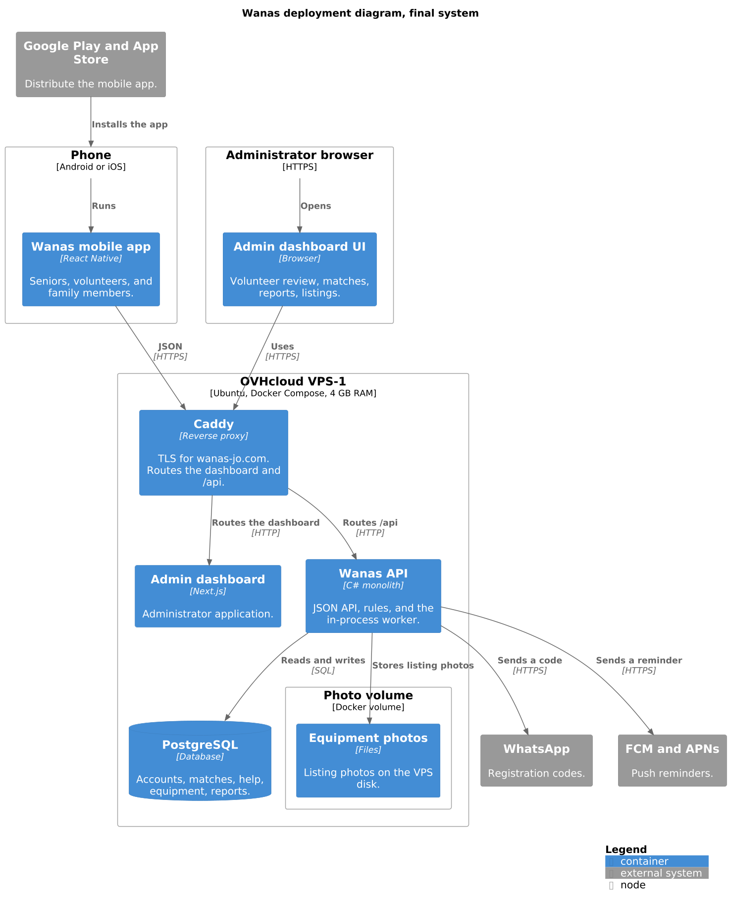

The phone and the administrator’s browser sit outside the VPS. Google Play and the App Store install the app onto the phone. They do not run on the server. Public HTTPS stops at Caddy. Caddy routes the dashboard to the Next.js container and routes `https://wanas-jo.com/api` to the API. The API is the only container that opens PostgreSQL or the photo volume. WhatsApp, FCM, and APNs are called by that same API process.

## 9.3 What is deployed where

| Part | Where it runs | What it is for |
| --- | --- | --- |
| Wanas mobile app | The person’s phone, Android or iOS | Screens and local state for seniors, volunteers, and family members. Calls the API over HTTPS. Receives push on the phone. |
| Google Play and the App Store | Google and Apple | Publish the Android and iOS builds and install them on the phone. They are not containers on the VPS. |
| Caddy | Container on the VPS | TLS for `wanas-jo.com`. Routes the admin dashboard and `/api`. The only process that accepts public HTTPS. |
| Admin dashboard | Container on the VPS | Next.js application. Volunteer review, matches, reports, and listings, opened in the administrator’s browser. |
| Wanas API | Container on the VPS | C# monolith. JSON API, companionship rules, and the in-process worker for registration codes and reminders. |
| PostgreSQL | Container on the VPS | Accounts, matches, help, equipment, and reports. The API reaches it with SQL on the Docker network. The data files sit on the PostgreSQL volume. |
| Photo volume | Docker volume on the VPS disk | Equipment-listing photos. The API writes the files. The volume remains when the API container is replaced. |

## 9.4 Networking and external services

The VPS publishes the web ports and no database port (CV-11). Public HTTPS reaches only Caddy. PostgreSQL accepts connections only from the API container on the Docker network.

Caddy terminates TLS for `wanas-jo.com` (CV-14). On the Docker network it forwards the dashboard to the Next.js container over HTTP, and it forwards `https://wanas-jo.com/api` to the API over HTTP.

| From | To | Path |
| --- | --- | --- |
| Phone app | Caddy | JSON over HTTPS. |
| Administrator browser | Caddy | HTTPS for the dashboard, and JSON over HTTPS for `/api`. |
| Caddy | Admin dashboard | HTTP on the Docker network. |
| Caddy | Wanas API | HTTP on the Docker network, for `/api`. |
| Wanas API | PostgreSQL | SQL on the Docker network. |
| Wanas API | Photo volume | Listing photos on the Docker volume. |
| Wanas API | WhatsApp | HTTPS. A registration code. |
| Wanas API | FCM and APNs | HTTPS. A reminder. |
| FCM and APNs | Phone | Push to the installed app (TC-09). |
| Google Play and the App Store | Phone | Install of the mobile app. |

The phone loads OpenStreetMap tiles itself while a person places a home pin, as Section 5 describes. That request does not enter the VPS. The coordinates are saved later through the API.

## 9.5 Configuration and secrets

Container settings come from the environment (CV-12). Docker Compose on the VPS reads an env file when a container starts. That file is stored on the VPS. It is not copied into the image, and it is not committed to git (CV-05).

The file supplies:

| Secret | Used by |
| --- | --- |
| Database password and the API connection string | The API, to open PostgreSQL. PostgreSQL, to accept that login. |
| WhatsApp credential | The API, when the worker sends a registration code. |
| FCM credential | The API, when the worker sends an Android reminder. |
| APNs credential | The API, when the worker sends an iOS reminder. |

An image build stays free of machine-specific connection strings, the domain’s keys, and these credentials. The same pinned image can start on this host because the host supplies the values.

## 9.6 Deploy, update, and rollback

A release updates the Compose stack on the single VPS (CV-13). Production images use a pinned tag, so the running stack can be named from that tag (CV-08). The previous tag is kept on the host.

The API release does two steps, in this order (CV-15):

1. Entity Framework migrations run against PostgreSQL, so the schema matches the version that is about to serve traffic.
2. The new API image starts. It serves `https://wanas-jo.com/api`, and the worker starts inside that same process.

The admin dashboard is deployed the same way: the stack points at a new pinned Next.js tag, and the previous tag is kept. The dashboard and the API are on `wanas-jo.com` before a store release. Android and iOS builds are published against that API (CV-17).

Rollback starts the previous tag again from the same compose file (CV-16). That start does not replace the PostgreSQL volume or the photo volume. The data on disk remains the data those volumes already hold.

## 9.7 Logging, monitoring, and backup

Logs are the container logs of Caddy, the admin dashboard, the API, and PostgreSQL. A log line records the operation and the failure. It omits passwords, phone numbers, and home addresses (CV-04).

The host is one small VPS. Monitoring is the team reading those container logs and checking the machine: whether the four containers are running, and whether memory and the 40 GB disk still have room. The team does this on the host it already administers (OC-03).

The backup is OVHcloud’s daily backup of the VPS, which keeps the previous 24 hours (TC-01). The PostgreSQL volume and the photo volume are files on that machine, so they are part of the same backup. This daily backup is the backup approach. It is not a second backup product.

## 9.8 References

- Section 2, especially TC-01, TC-02, TC-03, TC-05, TC-07, TC-09, TC-12, OC-03, and CV-04 through CV-17.
- Section 4, for the monolith, the in-process worker, and the single Compose stack on the VPS.
- Section 5, for the containers this deployment places on the phone and on the VPS.
- arc42 Section 9, Deployment View: https://docs.arc42.org/section-9/


# 10. Security and Quality

| | |
| --- | --- |
| **Project** | Wanas (ونس) |
| **Document section** | arc42 — Section 10: Security and Quality |
| **Status** | Draft for the final system |

This section records how the final system checks who is calling, what that person may do, and which pilot quality goals the design is built to support. The rules below are the ones already set in Sections 1, 2, 7, and 8.

## 10.1 Authentication

Seniors, volunteers, and family members sign in with a WhatsApp one-time code. They use the same two registration calls. The `role` in the body decides which account is created. The API asks WhatsApp to deliver the code. The response does not contain the code. A correct code stores the account, removes the used code, and returns the session token.

Administrators use their own staff sign-in. A staff account already exists. The administrator requests a code on the staff path. The API sends that code when the phone already belongs to an administrator. A verified code returns a session token with the role `Admin`.

The session is a bearer token. The token carries one role: `Senior`, `Volunteer`, `Family`, or `Admin`. A signed-in request sends `Authorization: Bearer <token>`.

| Situation | Result |
| --- | --- |
| The token is missing or not valid. | `401` `unauthorized` |
| The account is locked. | `403` `account_locked`. Stored rows stay unchanged. |

## 10.2 Authorization

The four roles are Senior, Volunteer, Family, and Admin. The API allows a call when the token's role is the role that call is listed for. A call for another role returns `403` `forbidden`. Stored rows stay unchanged.

A family member has a separate account. A family member never uses the senior's password. The member is linked to a senior only after that senior gives consent. Each link has its own permissions. `CanViewSchedule` and `CanCreateHelpRequest` can differ from one family member to another. The senior can withdraw a link. Withdrawal sets consent to Revoked and clears the permission flags. The family account stays.

A family call also checks that link. Approved consent and the flag for that call are both required. A missing link or a missing permission returns `403` `forbidden`.

## 10.3 Private data

The phone number is stored on the account. The home pin is stored on the senior profile or the volunteer profile.

A response about the caller may include that caller's own phone number and home pin. A response about another person includes `areaName` and a display name only.

Logs record the operation and the failure. Logs omit passwords, phone numbers, and home addresses.

Secrets are supplied at container start. Database passwords, API keys, and Firebase or Apple credentials are provided when the container starts.

## 10.4 Input validation

The API checks the JSON before it changes data. Screens can guide the user. The rule lives in the API.

These checks are the ones already defined for the stored data.

| Check | Rule |
| --- | --- |
| Role | The value is Senior, Volunteer, Family, or Admin. |
| Active match | A match is active only after both sides have a recorded acceptance. |
| Help category | The category is grocery shopping, transportation or accompaniment, technology help, or a small errand. |
| Equipment listing type | The listing type is Donate, Lend, or Request. |

A value outside the check is rejected. The API leaves the stored rows unchanged. The help categories stay on those four everyday tasks, which is the product boundary in OC-04.

## 10.5 Quality goals

The measurable targets below come from Section 1. Each one is an assumption for the pilot. The team reviews it after testing with real users.

| ID | Pilot assumption | Design choice that supports it |
| --- | --- | --- |
| QT-04 | Every active match in the pilot has recorded acceptance from both sides. | Recorded acceptance. A match becomes active only when both acceptance times are stored. |
| QT-05 | Every reported safety concern has a recorded review and outcome. | Recorded report outcomes. The report stores the outcome, and the review writes an `AdminAction`. |
| QT-06 | No user can access another user's private information without permission. | Role checks and response filtering. The API checks the role and the family-link permissions. A response about another person returns `areaName` and a display name only. |

Three further qualities come from the same requirements and from the single-host deployment.

| Quality | What this design provides |
| --- | --- |
| Reliability | PostgreSQL stores profile, match, and request changes on a Docker volume. Migrations run before the new API serves. |
| Maintainability | Accounts, profiles, matches, scheduling, notifications, safety, and administration are separate modules in one monolith. |
| Availability | The service runs on one VPS. A host failure stops the service. The previous image tag can be started again. |

## 10.6 References

- Section 1, for NFR-01 through NFR-12 and QT-01 through QT-06. This section uses QT-04, QT-05, and QT-06.
- Section 2, for TC-10, TC-11, OC-04, OC-05, CV-03, CV-04, and CV-05, and for the single VPS, the Docker volume, migrations before the new API serves, and the previous image tag.
- Section 7, sections 7.4 and 7.5, for role values, match acceptance, help categories, listing types, family-link consent, and locks that keep stored rows.
- Section 8, for shared sign-in, the bearer token, `401` and `403` results, and family permission checks.
- arc42 Section 10, Quality Requirements: https://docs.arc42.org/section-10/
- OWASP Application Security Verification Standard: https://asvs.owasp.org/


# 11. Architecture Decisions, Trade-offs, and Risks

| | |
| --- | --- |
| **Project** | Wanas (ونس) |
| **Document section** | arc42 — Section 11: Architecture Decisions, Trade-offs, and Risks |
| **Status** | Draft for the final system |
| **Related section** | Section 4 records the solution strategy. This section records each accepted decision, what it gave up, and the risks that remain. |

This section describes the final Wanas companionship system. The decisions below are accepted. Each record states the context, the alternatives set aside, and the consequences. The records live in [adr](adr/).

## 11.1 Architecture decisions

| ADR | Decision |
| --- | --- |
| [ADR 0001](adr/0001-monolith-on-one-vps.md) | One C# monolith on the single OVHcloud VPS-1: the API, domain rules, Entity Framework, and the in-process worker are one process. |
| [ADR 0002](adr/0002-react-native-and-admin-dashboard.md) | One React Native app for seniors, volunteers, and family members, and a separate Next.js dashboard for administrators. |
| [ADR 0003](adr/0003-postgresql-entity-framework.md) | PostgreSQL with Entity Framework Core. A senior has one match row. A volunteer can appear on many. |
| [ADR 0004](adr/0004-confirmed-match-suggestions.md) | Suggestions are computed in the monolith and stay inactive until an administrator confirms them and both people accept. |

## 11.2 Trade-offs

| Decision | Gained | Given up |
| --- | --- | --- |
| [ADR 0001](adr/0001-monolith-on-one-vps.md) | One process and one Compose stack on 2 vCores and 4 GB RAM. The API, the rules, Entity Framework, and the worker deploy together, with the dashboard, PostgreSQL, and the Caddy TLS proxy on the same host. | Microservices and a second server. The parts of the stack share one machine and one memory budget. |
| [ADR 0002](adr/0002-react-native-and-admin-dashboard.md) | One Android and iOS app, one admin dashboard, and one JSON API. Arabic and English, including right-to-left layout. | A public website for the three participant roles, Razor or Blazor screens inside the monolith, and separate Swift and Kotlin apps. |
| [ADR 0003](adr/0003-postgresql-entity-framework.md) | Relational records for accounts, matches, acceptances, consent, help requests, and equipment. EF Core stays in the infrastructure layer and produces the migrations. One senior, one match row. | A second database server, and Dapper with hand-written SQL. The volunteer side of a match has no cap. |
| [ADR 0004](adr/0004-confirmed-match-suggestions.md) | Suggestions from shared interests, language, and area, kept inactive until an administrator confirms the pair and the senior and the volunteer both accept. | A fully manual match with no suggestions, a suggestion that becomes active on its own, and a separate matching service. |

## 11.3 Risks, limitations, and unresolved questions

- The single VPS is a single point of failure. A host outage stops the API, the dashboard, and the database together.
- WhatsApp must deliver the registration code. If it refuses, no account is created.
- A rejected push leaves the call scheduled and marks the reminder failed. The people can miss the reminder.
- The home pin is stored for area matching. A bug in a response could expose it. Responses about another person are supposed to return `areaName` only.
- Equipment handover is recorded in Wanas. The physical meeting still happens outside the software, in a public arrangement.
- One volunteer can be matched to many seniors, which can overload that volunteer. The product does not yet cap how many seniors one volunteer holds.
- In-app chat and in-app voice or video are not in this design. Contact stays a scheduled phone call.

These questions are still open:

- Which OVHcloud datacenter hosts the VPS-1. Section 2 leaves the location open. Hosting in Jordan is not required.
- How many seniors one volunteer may hold. ADR 0003 allows many match rows for one volunteer and sets no maximum.

## 11.4 References

- Section 4, especially 4.2 and 4.3.
- Section 2, for the single VPS, PostgreSQL, React Native, and match acceptance.
- Section 7, for the one-senior match row and equipment handover.
- arc42 Section 11, Risks and Technical Debt: https://docs.arc42.org/section-11/
- ADR templates: https://adr.github.io/adr-templates/


# 12. Cross-Cutting Concepts and Glossary

| | |
| --- | --- |
| **Project** | Wanas (ونس) |
| **Document section** | arc42 — Section 12: Cross-cutting Concepts and Glossary |
| **Status** | Draft for the final system |

These rules apply to every module. The mobile app, the admin dashboard, and the API use the same words for the same records.

## 12.1 Error handling

Every failed API call returns one JSON object:

```json
{ "error": "invalid_code" }
```

The `error` value is a stable code the client can show in Arabic or English. The HTTP status says which kind of failure it is.

| Status | Meaning | What happens to stored data |
| --- | --- | --- |
| 400 | The JSON failed validation. | Nothing is written. |
| 401 | The token is missing or not valid. | Nothing is written. |
| 403 | The account is locked, or the role or family permission does not allow the call. | The row is left as it is. |
| 404 | The id does not match a row the caller may see. | Nothing is written. |
| 409 | The call conflicts with the current status, such as a phone that already has an account, or a match that is not active. | Nothing new is written. |
| 502 | WhatsApp did not accept the registration message. | The pending code is removed. |

A locked account uses `account_locked`. A role or permission refusal uses `forbidden`. Clients show the failure. They do not decide the rule.

## 12.2 Validation

The API checks the body before it changes PostgreSQL. Screens in the mobile app and the admin dashboard can guide the person, and the stored rule stays on the server.

The checks that apply across modules:

| Check | Where it is enforced |
| --- | --- |
| Role is Senior, Volunteer, Family, or Admin. | `Account.Role`. |
| Preferred language is `ar` or `en`. | Account and profile. |
| A match is active only after the senior and the volunteer have both accepted, and an administrator has confirmed it. | `Match.Status` and the acceptance timestamps. |
| A call is stored only for an active match. | The scheduling use case reads `Match.Status` first. |
| A help category is grocery shopping, transportation or accompaniment, technology help, or a small errand. | `HelpRequest.Category`. |
| A listing type is donate, lend, or request. | `EquipmentListing.ListingType`. |
| A family action requires an approved link and the matching permission flag. | `FamilyLink.ConsentStatus` and the flag for that action. |

## 12.3 Logging

The API and the admin dashboard write to container logs on the VPS. A log line names the operation and the failure code. It omits passwords, bearer tokens, phone numbers, and home coordinates. The team reads those logs on the single host. There is no separate log product.

## 12.4 Security conventions

Sign-in for a senior, a volunteer, or a family member is a WhatsApp code, then a bearer token. An administrator uses the staff sign-in and receives a token whose role is Admin. The token carries one role. Database passwords, the WhatsApp credential, and the FCM and APNs credentials are supplied when the container starts. They are not stored in git or in the image.

A response about the caller may include that caller's own phone number and home pin. A response about another person includes `areaName` and a display name. Section 10 states the quality goals that depend on this rule.

## 12.5 Modules and shared names

The API is one C# process. Inside it, accounts, profiles, matching, scheduling, help requests, equipment, notifications, safety, and administration are separate modules. A change to matching does not require a change to registration or to notification delivery. The mobile app and the dashboard render state and call the API. They do not keep a second copy of these rules.

Code and documents use the product words below. A table name, a JSON field, and a sentence in this document should point at the same concept.

## 12.6 Glossary

| Term | Meaning in Wanas |
| --- | --- |
| Account | The login for one person. It has one role, one phone number, a display name, and a preferred language. |
| Role | Senior, Volunteer, Family, or Admin. The bearer token carries one role. |
| Profile | The senior or volunteer record attached to an account: area, interests, language, and, for a volunteer, availability and verification. |
| Home pin | The latitude and longitude a senior or volunteer places on the map. It is stored for area matching and is returned only to that person. |
| Area name | The place name other people see. It replaces the home pin and the phone number in those responses. |
| Family link | The record that connects one family account to one senior after consent. It holds the permission flags. |
| Consent | The senior's decision on a family link: pending, approved, or revoked. Revoking it clears the permission flags. |
| Match | The one volunteer linked to a senior. The row moves from proposed, to offered, to active, or to declined or ended. |
| Suggestion | A proposed match chosen from shared interests, language, and area. It is not an active match. |
| Acceptance | The senior's or the volunteer's decision on an offered match. Both are required before the match is active. |
| Interaction | A scheduled phone call on an active match: start time, status, and reminder status. The audio call stays on the telephone network. |
| Help request | An everyday request in one of the four allowed categories. It belongs to a senior and can name the volunteer who accepted it. |
| Equipment listing | A donate, lend, or request item. It has a status, an owner, and optional photos. |
| Handover | The recorded collection arrangement for a listing. The meeting itself happens outside the software. |
| Safety report | A concern filed by a signed-in person. An administrator records the outcome. |
| Admin action | The kept record of a lock, an unlock, an ended match, a hidden listing, or a report outcome, naming the administrator and the time. |
| Registration code | A one-time code sent on WhatsApp. It is stored until it is used or it expires, then deleted. |
| Bearer token | The session secret returned after a code is verified. Each later call sends it as `Authorization: Bearer`. |
| Locked account | An account with `IsLocked` set by an administrator. Signed-in calls return `403` and leave other rows unchanged. |

## 12.7 References

- Section 2, for the conventions on validation, errors, logs, and secrets.
- Section 7, for the columns these terms name.
- Section 8, for the error body and the role checks.
- Section 10, for authentication and private data.
- arc42 Section 12, Cross-cutting Concepts: https://docs.arc42.org/section-12/

